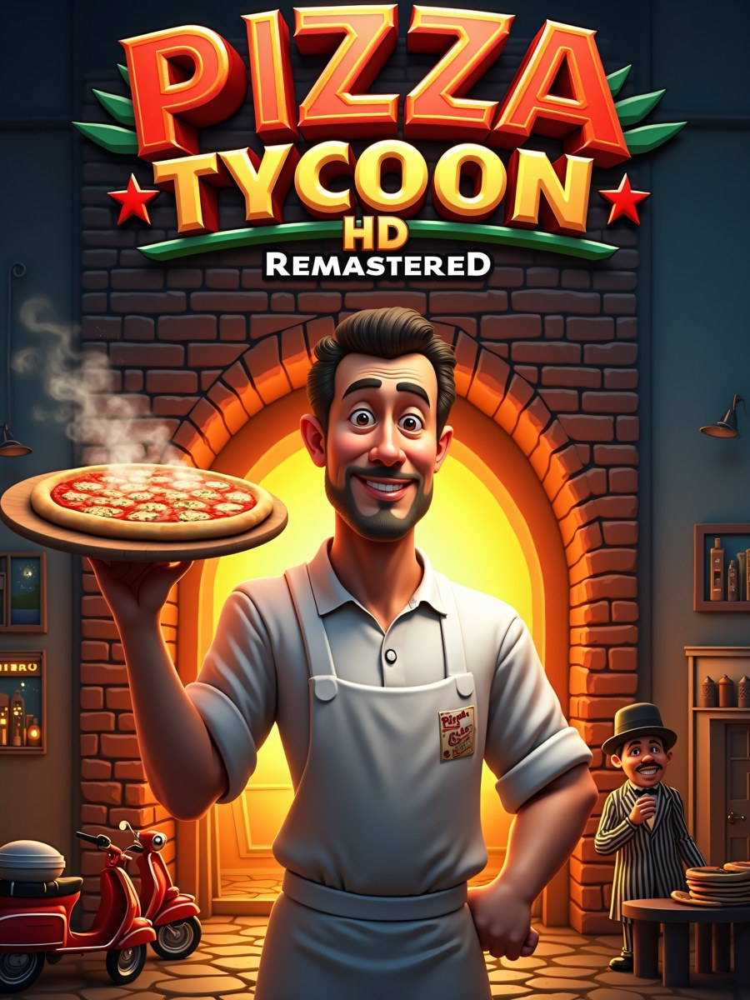
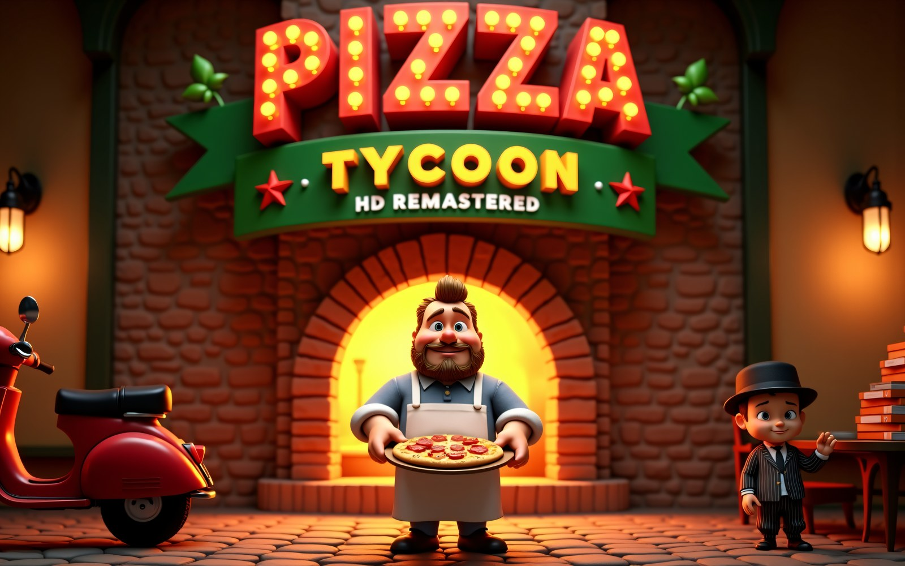
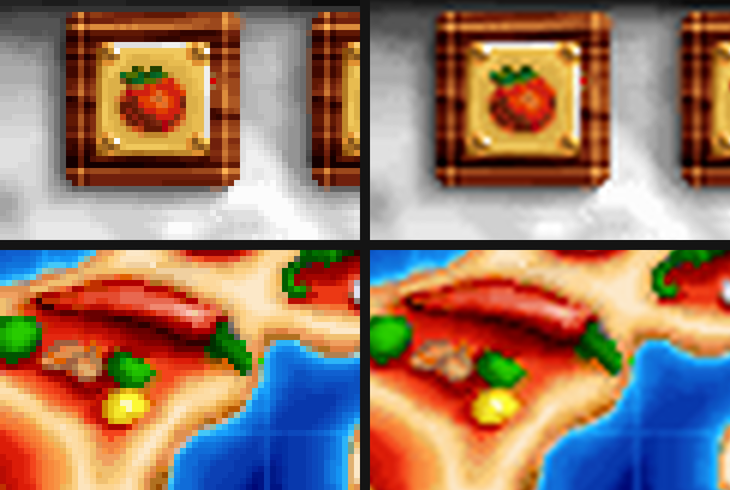
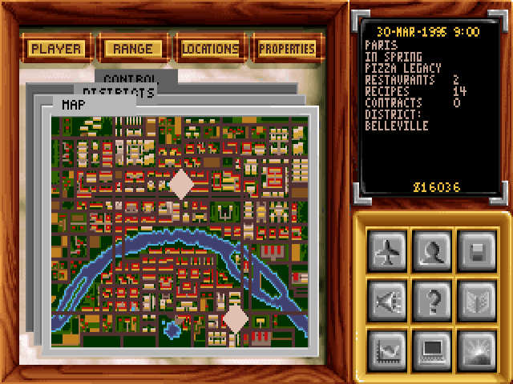
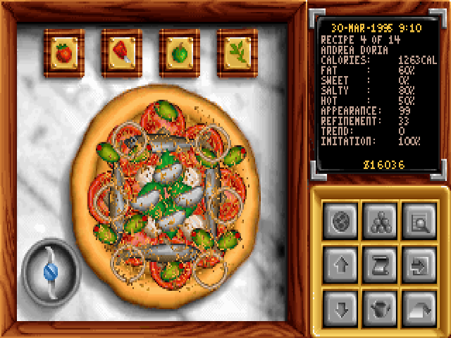

# Pizza Tycoon HD

An HD remaster path for the 1994 DOS game **Pizza Tycoon** (Pizza Connection),
built on [Pizza Legacy](https://codeberg.org/cowomaly/pizzalegacy), the
open-source C++20 reimplementation of the game by Cowomaly.

Everything Pizza Legacy does is kept: the full game, start to finish, with the
original rules. This fork adds:

* **HD rendering**: the game screen drawn at up to 8x (3840x2400 at 6x),
  set with `hd_scale` or `--hd-scale`.
* **HD art packs**: any of the 1,699 original pictures and sprite frames can
  be replaced by a PNG of any size; missing ones keep the original art.
* **Asset export**: `--export-assets` writes every original picture with its
  correct palette, plus a `manifest.json`, in exactly the pack layout.
* **Pack tools** (`tools/hdpack`): a baseline upscaler, a validator that
  checks a pack the way the engine will, and a batch driver for a local
  ComfyUI (RTX GPU) to generate remastered art.

  
  

*New 4K art made for this remaster with Flux on a local GPU: the box cover
(2880x3840, `assets/art/`) and the title screen (3840x2400,
`assets/hd/gfx/titel1.png`, shown in game when `hd_scale` is 2 or more).*

*Left: original art, scaled up. Right: the same spot rendered at
`hd_scale 6` (3840x2400) with the baseline, non-AI pack. This shows the HD
pipeline works end to end; remastered art comes from the ComfyUI step.*

**Start here:** [docs/HD_REMASTER.md](docs/HD_REMASTER.md) (workflow, settings,
ComfyUI setup, limits).

| Script (Windows) | What it does |
|---|---|
| `scripts\doctor.ps1` | Checks tools, dependencies, game folder, ComfyUI |
| `scripts\build.ps1` | Release build (vcpkg + CMake + Ninja), tests included |
| `scripts\test.ps1` | C++ tests (no window), Python tests, format and lint checks |
| `scripts\export-assets.ps1` | Writes the original art to `export\` |
| `scripts\make-pack.ps1` | Builds `pack\` (baseline upscale or ComfyUI) and validates it |
| `scripts\run-dev.ps1` | Plays the game with a pack at a chosen scale |
| `scripts\release.ps1` | Packages the Windows zip, with checksums |
| `scripts\ci-local.ps1` | All quality gates, run locally (no hosted CI) |

Linux and macOS: `scripts/fetch-deps.sh`, `scripts/build.sh`,
`scripts/test.sh`, `scripts/ci-local.sh`.

Windows build from Linux or WSL2 (no Visual Studio needed):
`scripts/build-windows-cross.sh` makes one self-contained
`Pizza Legacy.exe` and the release zip in `release/`.

The Windows program has no console window. Started from a terminal, it prints
there (exports, `--help`).

The rest of this file is Pizza Legacy's own README.

---

# Pizza Legacy

Pizza Legacy is an open-source reimplementation of the 1994 DOS game
Pizza Tycoon (released as Pizza Connection in Germany). The goal is to
faithfully reimplement the game as a new engine written in modern C++20.
The game itself is fully reimplemented; only the assets (graphics, sounds,
etc.) come from the original, so you will need the original game to play.

Website: [pizzalegacy.nl](https://pizzalegacy.nl)

## Downloads

Prebuilt releases of Pizza Legacy for Windows, macOS, and Linux are available
on Codeberg:
[https://codeberg.org/cowomaly/pizzalegacy/releases](https://codeberg.org/cowomaly/pizzalegacy/releases)

## Getting the original game

Pizza Legacy requires the asset files from the original English-language DOS
version of Pizza Tycoon / Pizza Connection. The game is available digitally and
frequently goes on sale for under a euro:

- [GOG](https://www.gog.com/en/game/pizza_connection)
- [Steam](https://store.steampowered.com/app/598990/Pizza_Connection/)

If you have a legal copy of the original DOS game on disk, that works too.

The original game manual is available online at
[pizzatycoon.org](https://www.pizzatycoon.org/p/manual.html).

## Running the game

On first launch, Pizza Legacy asks you to select the folder containing your
original game files (the folder with `PT.EXE` in it). Steam and GOG
installations are detected automatically: you can point at your Steam or GOG
directory, at `steamapps/common`, or at the Pizza Connection folder itself.

Settings, key bindings, saved games, and screenshots are stored per user:

- **Windows:** `%APPDATA%\nl.pizzalegacy\Pizza Legacy\`
- **macOS:** `~/Library/Application Support/nl.pizzalegacy/Pizza Legacy/`
- **Linux:** `~/.local/share/nl.pizzalegacy/Pizza Legacy/`

This directory contains subdirectories for `saves/` (saved games),
`screenshots/` (in-game screenshots), and `recipes/` (pizza recipe `.pc`
files). On the recipe list, right-click a recipe to export it to `recipes/`
or right-click the NEW row to import recipe files. Standard pizzas can't be
imported or exported.

Game settings (resolution, volume, autosaves, optional bug fixes, and more)
are changed from the in-game options screen. The rules (bug fixes, quality of
life improvements, win condition and advanced balance options) are stored
in the save game, so a loaded game keeps the rules it was started with.
Changing them from the main menu changes the rules for new games; to change a
game you are already playing, load it first and change them from the disk menu.
In that menu you can use "Save rules for new games" to store these settings and
use them for new games from then on. Keyboard and gamepad bindings are changed
on the Key bindings screen under Controls, or by editing `bindings.conf` in the
directory above; the file is created on first launch and documents all actions
and their default bindings.
gamepad bindings are changed on the Key bindings screen under Controls, or by
editing `bindings.conf` in the directory above; the file is created on first
launch and documents all actions and their default bindings.

## Current status

Pizza Legacy is now feature-complete. Every major gameplay system has been
implemented and the game can be played from start to finish.
Development is currently focused on extensive playtesting, balancing, bug
fixing, and general polish before the next stable release. See
[docs/CHANGELOG.md](docs/CHANGELOG.md) for recent changes.

### Enhancements

While the goal of the project is a faithful reimplementation, Pizza Legacy
includes several quality-of-life improvements and bug fixes for the original
game. See [docs/MODERNIZATIONS.md](docs/MODERNIZATIONS.md) for a full list of
intentional differences.

Some examples:

- Auto-saving, plus a save/load menu showing in-game date, players and city
- Keyboard navigation throughout menus
- Modern mouse support: drag-scrolling and zooming the city map, scroll wheels in lists
- Support for modern displays, including configurable scaling and vsync
- Optional fixes for original bugs, such as the win condition only checking
  Paris instead of all ten cities

## Building

See [docs/BUILDING.md](docs/BUILDING.md) for details.

## Architecture

See [docs/ARCHITECTURE.md](docs/ARCHITECTURE.md) for details about the engine.

## Contributing

Questions and bug reports are welcome via [Codeberg
Issues](https://codeberg.org/cowomaly/pizzalegacy/issues). When reporting a
bug, please include the Pizza Legacy version, your operating system, and what
you expected to happen. If the problem occurs in a running game, attaching a
saved game from the `saves/` directory (see [Running the
game](#running-the-game)) and the steps to reproduce can help a lot.

Development
currently happens offline and updates are pushed periodically, so pull requests
may not be reviewed immediately. For larger contributions, it's best to open an
issue first to discuss the approach.

## License

Pizza Legacy is licensed under the
[GNU General Public License v3.0](https://www.gnu.org/licenses/gpl-3.0.html).

Third-party libraries are in the `third_party/` directory, each with their
own license. See [docs/CREDITS.md](docs/CREDITS.md) for details.
