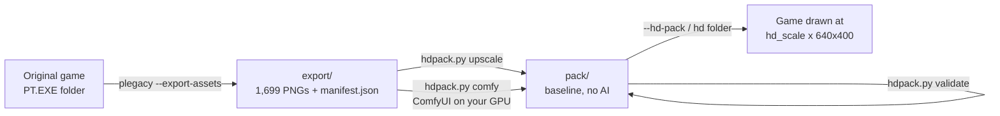

# HD remaster: how it works and how to make a pack

Pizza Tycoon HD keeps every rule, number and screen layout of Pizza Legacy (and
so of the 1994 original) and adds one thing: any original picture can be
replaced by a high-resolution PNG, and the game is drawn at up to 3840x2400.



## What there is to replace

Exported from the English DOS release with this engine's own decoders and
palettes:

| Kind | Files | Images | Sizes (original pixels) |
|---|---|---|---|
| VGA pictures (`gfx/`, `z/`) | 145 | 145 | 320x200 screens, 192x176 rooms, 64x46 portraits, icon strips |
| BOB sprites (`bob/`) | 51 | 1,554 frames | 9x11 guests up to ~120x120 characters |
| **Total** | 196 | **1,699** | |

Many BOB frames are animation poses of the same subject (25 character types x
6 frames, 13 walk cycles x 12 frames, 341 furniture pieces, 322 ingredients).
Fonts (`fonts/*.fnt`) are not pack files: at `hd_scale` 2 or more every line
of text is drawn again with a modern typeface (see [HD text](#hd-text)).

## Quick start

```powershell
# 1. Export the original art (no window opens)
.\scripts\export-assets.ps1 -GamePath "C:\GOG Games\Pizza Connection"

# 2a. Baseline pack, no AI, a couple of minutes
.\scripts\make-pack.ps1 -Mode upscale

# 2b. Or with ComfyUI on the RTX 3090 Ti (see below)
.\scripts\make-pack.ps1 -Mode comfy -Checkpoint "juggernautXL_v9.safetensors" -UpscaleModel "4x-UltraSharp.pth" -Limit 10

# 3. Check, then play at 1920x1200
.\scripts\run-dev.ps1 -HdScale 3
```

No engine build on the GPU machine? `tools/hdpack/export.py` writes the same
export with Python only (checked pixel for pixel against the engine):
`python tools/hdpack/export.py "<folder with PT.EXE>" export`.

When another job may be using a second GPU, add `--wait-gpu <index>` to
`hdpack.py comfy`: it waits before each picture until that GPU is below
`--wait-below` percent busy, so two cards never run flat out together.

On Linux/macOS the same steps are:

```sh
plegacy --game-path ~/games/pizza --export-assets export
python3 tools/hdpack/hdpack.py upscale export pack --scale 6
python3 tools/hdpack/hdpack.py validate export pack
plegacy --hd-scale 3 --hd-pack pack
```

## Settings

| Setting (`settings` file) | Command line | Meaning |
|---|---|---|
| `hd_scale = 1..8` | `--hd-scale N` | Texels per pixel of the 640x400 game screen. 1 = original. 3 = 1920x1200, 4 = 2560x1600, 6 = 3840x2400. Read at startup. |
| `hd_pack = <folder>` | `--hd-pack <folder>` | The pack. Empty means a folder called `hd` next to the program, if there is one. |
| `hd_text = true` | | HD text: modern typefaces instead of the 1994 letters (see [HD text](#hd-text)). Options menu: "HD text". |
| `lighting = true` | | HD lighting in the restaurant (see [HD lighting](#hd-lighting)). Options menu: "Lighting". |
| `smooth_motion = true` | | Walking guests and waiters glide between steps at the screen's frame rate. Only the drawing changes: the game state is the same with it on and off (an HD gate checks this). Options menu: "Smooth motion". |

A pack, HD text and lighting are used only when `hd_scale` is 2 or more. With
`hd_scale` above 1 and no pack, the game is drawn at the higher resolution
with the original pixels (sharp, no blur from the GPU stretching a small
frame).

## Pack layout and rules

The pack mirrors the export, lower case, forward slashes:

```
pack/gfx/back1.png           replaces GFX/BACK1.VGA
pack/gfx/euromap.png         replaces GFX/EUROMAP.VGA
pack/z/zb3.png               replaces Z/ZB3.VGA
pack/bob/moebel/0012.png     replaces frame 12 of BOB/MOEBEL.BOB
```

* **Any size, same shape.** The engine resizes each PNG once, on first use, to
  exactly the original size x 2 x `hd_scale` (area-averaged when shrinking,
  bilinear when growing, in premultiplied alpha so edges stay clean). The
  aspect ratio must be within 2% of the original's or the file is ignored with
  a warning. 12x the original is a 1:1 match for `hd_scale` 6.
* **Missing files keep the original.** Packs can be built a few pictures at a
  time.
* **Transparency.** Index 0 in the original is see-through. In the HD art,
  alpha does the same, and soft alpha edges may reach a little past the
  original outline. Inside the original outline the HD art should be opaque;
  `hdpack.py validate` flags sprites where more than 5% of it is see-through.
* **Colours are absolute.** The original recolours some things with palette
  tricks (screen fades are kept; fades darken HD art too). Palette *cycling*
  and per-scene palette swaps do not change HD art, which shows the colours it
  was painted with.

## How the engine does it

The game logic never sees HD art. Everything is still drawn into 8-bit indexed
640x400 surfaces, so hit-testing, layout and every screen work exactly as
before. Next to its indexed pixels, each `gfx::Surface` keeps a **draw list**
(`gfx::HdList`, `src/engine/gfx/HdList.h`): the HD pictures drawn on it, each
with where it goes, which part of the picture, and an optional tint. No HD
texels are copied on the CPU.

* Loading a VGA picture or a BOB frame attaches the pack's picture, if any:
  a list of one entry covering the whole surface.
* Every drawing operation keeps the list in step with the indexed pixels:
  * blitting a surface appends the source's pictures, clipped and moved to
    where the blit lands;
  * drawing *plain* pixels (lines, fills, sprites with no HD art) ends the
    HD pictures under those pixels, so the original pixels show through
    there. This is why every screen keeps working with a partial pack.
* Per layer, `HdCompositor` expands the 640x400 indexed pixels (cheap) and
  draws the list over them as textured quads, on the GPU, into a render
  target `hd_scale` times the layer's size. Pictures are uploaded once and
  kept in GPU memory (1.5 GiB budget, least recently used dropped first);
  small ones share atlas pages. Layer render targets are pooled and reused
  from one screen to the next. The layers are then combined and scaled to
  the window (letterboxed, CRT aspect if enabled). Every SDL renderer works
  (Direct3D 11/12, Vulkan, Metal, OpenGL); only textured quads and
  premultiplied-alpha blending are used, no custom shaders.
* `PLEGACY_CPU_COMPOSE=1` selects the CPU fallback (for broken GPU drivers,
  and for the tests): each layer is expanded at `hd_scale` on the CPU, rows
  split across threads, and uploaded as one texture. It draws the same
  picture (the tests and an HD gate compare the two), about 25 times slower.

Frame time, measured on 2026-11-14 with `bench` in a restaurant, every layer
redrawn every frame, at 3840x2400 on Direct3D 11 with an RTX-class GPU and a
Ryzen 7 5800X3D:

| Compositing | avg | p99 |
|---|---|---|
| GPU (default) | about 3 ms | 4.4 ms |
| CPU (`PLEGACY_CPU_COMPOSE=1`) | 80 ms | 143 ms |

How fast a screen opens (its first frame) and the 8 ms p99 limit are checked
by the HD gates (`scripts/hd-gates.ps1`, `tools/ci/hd_gates.py`), which print
both numbers on every run with the original game.

**DLSS and similar** do not apply: they need a 3D renderer with motion vectors
and depth. This is a 2D game drawn at native resolution, so there is nothing
for them to reconstruct.

## ComfyUI on the RTX 3090 Ti

`tools/hdpack/hdpack.py comfy` sends each exported picture through a ComfyUI
workflow and writes the result into the pack. It talks to ComfyUI's own HTTP
API (`/upload/image`, `/prompt`, `/history`, `/view`) on `127.0.0.1:8188`; no
custom nodes are needed for the shipped workflows.

1. Start ComfyUI (portable build is fine) with the 3090 Ti as its GPU. To keep
   the 3060 for other work, set `CUDA_VISIBLE_DEVICES` to the 3090 Ti's index
   before starting it.
2. Put an upscale model in `ComfyUI/models/upscale_models` and, for the refine
   workflow, an SDXL checkpoint in `ComfyUI/models/checkpoints`.
3. Check everything:
   `python tools/hdpack/hdpack.py doctor --checkpoint <file> --upscale-model <file>`
4. Try ten pictures first: add `--limit 10`, look at them in the game, adjust
   `prompts.json` (prompt and `denoise` per group of files), then run the
   rest. Runs resume: files already in the pack are skipped unless `--force`.

Sprites and other small pictures are best done without AI:
`hdpack.py upscale export/ pack/ --scale 12 --method mmpx --only 'bob/*'`
magnifies them with MMPX, a pixel-art scaler that keeps edges and colours
(about 20 s for all 1,554 frames). Diffusion models need more pixels than a
32x40 sprite has.

Workflows (`tools/hdpack/workflows/`, ComfyUI API format with `{{placeholders}}`):

* `upscale_only_api.json`: two model upscale passes (16x), then a resize to
  the target. Fast and faithful; no new detail is invented.
* `sdxl_refine_api.json` (default): model upscale, then SDXL img2img at a low
  denoise so the layout stays and the detail is redrawn, then a second model
  upscale so the final resize to 4K starts from a sharp picture. Sprites are
  sampled with the long side at 1024 or more and scaled down afterwards,
  because diffusion models make poor pictures far below their training size.
  The original's transparency is put back on every sprite.

Pictures smaller than 4096 original pixels (width x height, so about 64x64)
skip the diffusion model and go through `--small-workflow` (by default
`upscale_only_api.json`). A first test on an RTX 3060 showed why: a 9x11
sprite or a 64x46 sheet of portrait frames carries too little detail, and
SDXL turned faces and figures to mush. Change the limit with `--small-area`;
`--small-area 0` sends everything through the main workflow.

For 4K, use `--scale 12`: the originals are 320x200, the engine's logical
screen is 640x400, and 12x the original is 3840x2400. The default 6x is
1920x1200.

To use your own workflow, export it from ComfyUI with *Save (API Format)* and
put these strings where the values go: `{{input_image}}`, `{{positive}}`,
`{{negative}}`, `{{seed}}`, `{{denoise}}`, `{{checkpoint}}`,
`{{upscale_model}}`, `{{gen_width}}`, `{{gen_height}}`, `{{width}}`,
`{{height}}`, `{{prefix}}`. Unknown placeholders are refused, so a typo can't
reach ComfyUI.

What to expect, by group:

| Group | Expectation |
|---|---|
| Rooms, maps, posters, newspaper pictures | Very good: big, static, low denoise keeps them faithful |
| Portraits, jury, chef | Good; check faces |
| Furniture, ingredients | Good, but run them as one batch with one prompt and seed so they match |
| Animated characters, walk cycles | Hardest: frames are generated one at a time and can drift. Use `upscale_only` or denoise 0.2 or lower, or paint one key frame and redo the rest by hand |
| Logos and anything with text | Keep denoise at 0.1-0.15; models garble letters |

## HD text

The game's seven bitmap fonts are 5 to 19 pixels tall. Scaled to 4K they stay
blocky, so at hd_scale 2 or more every line of text is drawn with a modern
TrueType typeface from `data/fonts`, rasterized with anti-aliasing by
stb_truetype at the exact texel size it is shown at:

| Original font | Used for | HD typeface |
|---|---|---|
| SUPERSMA, CSTANDAR, MINI | status panel, small labels (capitals only) | Chakra Petch SemiBold |
| ASTANDAR | most body text | Archivo ExtraBold, semi-expanded |
| MENU | menus | Crimson Pro Medium |
| PIZ-NUMB | numbers, tables, names | Fira Sans Medium |
| RUBY | headings | Zilla Slab Bold |

The layout doesn't change: lines break where the original breaks them, and
each line is laid out with the original font's line box, alignment (left,
centred or right) and baseline, at the original's cap height. A line that
would be wider than the original is narrowed to fit. Colours and drop
shadows are the original's.

The letters live only in the HD layer: in HD-text mode the indexed pixels
get no original letters, and keep whatever was under the text. Game state
never depends on the letters, so nothing the game does changes.

How the letters reach the screen:

* For each font size in use there is a **glyph sheet**: every printable
  ASCII letter in one picture, white, with the letter's coverage as alpha.
  The sheets are made on background threads while the intro plays.
* A line is then one GPU quad per letter from that sheet, tinted by the GPU
  to the text colour; the shadow is drawn first, the same way. A new line of
  text needs no new picture and no upload.
* A line with letters outside printable ASCII, or one narrowed to fit, is
  drawn instead as one picture per line, packed with others in shared atlas
  pages on the GPU.

`data/fonts/hd_fonts.json` maps each font to its typeface (`file`, a plain file
name in `data/fonts`: a name with a folder in it is refused), cap height
(`size`, a multiple of the original's), letter spacing (`tracking`, in
original pixels) and `uppercase` for the capitals-only fonts. All the fonts
there are under the SIL Open Font License. The `hd_text` option (also in the
graphics options, "HD text") switches back to the 1994 letters at any time.

## HD lighting

With `lighting` on (the default) and `hd_scale` 2 or more, the restaurant is
lit: candles, ovens and grills, arcade machines, TVs, the jukebox and the
vending machines light the room around them, with flicker, and the room
follows the game clock (bright by day, warm in the evening, dim and blue at
night). A screen reports its lights and ambient level (`lighting::Scene`,
`src/engine/Lighting.h`), and `LightPass` (`src/engine/LightPass.h`) lights
that layer on the GPU after `HdCompositor` has drawn it: a light map at
engine resolution (ambient plus a soft falloff per light), multiplied into
the layer, and an additive halo on the lights themselves. It uses only
fixed-function blending, so every SDL renderer can do it. Only the picture
changes; the CPU fallback has no lighting, so the HD gate that compares GPU
and CPU pictures turns it off.

## Redrawing furniture with depth (2.5D-ready art)

MMPX keeps the sprites faithful but they still look like magnified pixel
art. `tools/hdpack/redraw.py` paints them again as real HD art without
moving a single pixel of their outline:

1. `depthmaps.py <pack> <maps>` makes a depth map (Depth Anything V2 Large)
   and a normal map for every picture: about 6 pictures a second, so a few
   minutes for the whole pack.
2. `redraw.py` starts from the pack picture, lets SDXL (`juggernautXL_v9`)
   paint over it at denoise 0.8, and holds the shape and perspective with a
   depth ControlNet (`diffusers_xl_depth_full`, strength 0.85 until 90% of
   the steps). Every rotation of one piece of furniture shares a seed, so the
   four views match. The start picture and the depth map are blurred over
   about half an original pixel first: left sharp, the 1994 pixel grid
   survives the redraw and the ControlNet reads every pixel edge as a step.
3. The result is cut to the original sprite's alpha, so placement, click
   areas and everything the game checks stay the same. The original's
   painted floor shadow is kept, because the model tends to repaint it as
   part of the object.
4. The original's colours are put back over areas of about 1.5 original
   pixels (`--keep-colours`, `--keep-light`): SDXL likes to turn every chair
   into brown leather, and a cream seat should stay cream. The model's own
   picture is kept under `raw/`, so `--from-raw` redoes this step with other
   values in seconds, without ComfyUI.

```
python tools/hdpack/redraw.py pack/ maps/ redraw-out/ --server http://127.0.0.1:8188 \
    --denoise 0.8 --skip-done --items-json tools/hdpack/furniture_redraw.json
```

`furniture_redraw.json` lists the 286 restaurant and kitchen furniture
frames (`bob/moebel`, `bob/kuebobs`) that came out right, each with a
description. The rest keep their MMPX versions, which look better:

* plants: at this size the model turns leaves into blocks;
* patterns one original pixel wide (gingham tablecloths, button rows on the
  vending machines, the 'Modern Mix' and 'Office Chair' seats): the softened
  start picture no longer shows them and the model paints something else;
* lattices and other sprites full of holes (the partition wall, the
  'Traditio Romano' chair back): the outline keeps the pixel steps, so a
  smooth painting inside looks half done;
* lettering (the BLACK BOX, the jukebox name, the '59' sprite): models garble
  letters;
* a handful of chairs and tables where the model added things that aren't
  there (cups on a seat, plates and cutlery on a table, a second small chair).

Running several `--denoise` values side by side writes
`redraw-out/<denoise>/` folders and a `sheet.png` to compare them. About ten
seconds per frame on an RTX 3090 Ti. Name a fine pattern in the description
("blue and white striped seat") when there is one, or it comes out plain, and
look at every frame next to its original before it goes into a pack
(`review_pairs.py <pack> redraw-out/0.80 <items.json> pairs` writes them
side by side, 64 to a page): a contact sheet at thumbnail size hides most of
the failures above.
Copy `redraw-out/0.80/bob/` into the pack when you're happy with it (keep the
old folders: they're the pixel-art versions).

## HD coverage

How much of each major screen still reaches the player at 640x400 is
measured by the `coverage` HD gate (`tools/ci/hd_gates.py --checks coverage`,
part of `scripts/hd-gates.*` and so of local CI). In one hidden `--exec` run
at `hd_scale` 3 it quick-starts a game, turns lighting off (the light map
would hide flat pixels), opens each screen listed in
`tools/ci/coverage-budget.json` with its `nav` commands, and screenshots it.
For every engine pixel it then looks at the 3x3 texels drawn for it: when
all nine are equal the pixel is *flat*, which is what an indexed pixel
scaled up looks like. Flat areas in real HD art (a black background, a
plain panel) count too, so the number is a trend to keep down, not a
verdict on its own.

The report goes to `build/coverage`: `coverage.md` (worst screen first),
`coverage.json`, and `masks/<screen>.png`, with the flat pixels in white,
which shows where HD art is missing. Budgets are kept per pack and renderer
(`baseline@gpu` for the pack the gates build, `<pack folder>@gpu` for your
own, `@software` for SDL's software renderer). A screen fails when its share
rises above its budget by more than 0.2 percentage points, and a screen that
can't be opened fails too. When a screen gets better, the gate says so;
record the new, lower budget with `scripts\hd-gates.ps1 -UpdateCoverage`
(or `PLEGACY_COVERAGE_UPDATE=1 scripts/hd-gates.sh`), read the report, and
commit `tools/ci/coverage-budget.json`. A screen with no budget yet is a
skip, which local CI counts as a failure, so the first run on a PC needs
that update once.

## Legal

The engine is GPL-3.0-or-later. The original game's files are not included
and are not redistributable; you need your own copy (GOG and Steam sell it).
Exports and packs are made from that copy, so keep them for your own use
unless you have the rights to share them. `.gitignore` keeps `export/`,
`pack/` and `hd/` out of the repository.
