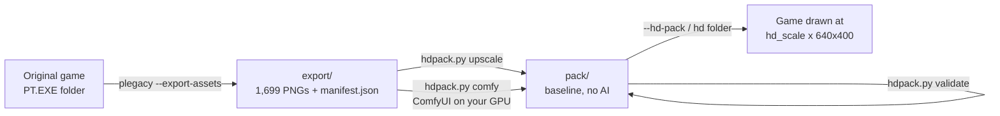

# HD remaster: how it works and how to make a pack

Pizza Tycoon HD keeps every rule, number and screen layout of Pizza Legacy (and
so of the 1994 original) and adds one thing: any original picture can be
replaced by a high-resolution PNG, and the game is drawn at up to 3840x2400.



## What there is to replace

Exported from the English DOS release with this engine's own decoders and
palettes:

| Kind | Files | Images | Sizes (original pixels) |
|---|---|---|---|
| VGA pictures (`gfx/`, `z/`) | 145 | 145 | 320x200 screens, 192x176 rooms, 64x46 portraits, icon strips |
| BOB sprites (`bob/`) | 51 | 1,554 frames | 9x11 guests up to ~120x120 characters |
| **Total** | 196 | **1,699** | |

Many BOB frames are animation poses of the same subject (25 character types x
6 frames, 13 walk cycles x 12 frames, 341 furniture pieces, 322 ingredients).
Fonts (`fonts/*.fnt`) are not part of a pack yet: text is drawn from the
original font, scaled up.

## Quick start

```powershell
# 1. Export the original art (no window opens)
.\scripts\export-assets.ps1 -GamePath "C:\GOG Games\Pizza Connection"

# 2a. Baseline pack, no AI, a couple of minutes
.\scripts\make-pack.ps1 -Mode upscale

# 2b. Or with ComfyUI on the RTX 3090 Ti (see below)
.\scripts\make-pack.ps1 -Mode comfy -Checkpoint "juggernautXL_v9.safetensors" -UpscaleModel "4x-UltraSharp.pth" -Limit 10

# 3. Check, then play at 1920x1200
.\scripts\run-dev.ps1 -HdScale 3
```

On Linux/macOS the same steps are:

```sh
plegacy --game-path ~/games/pizza --export-assets export
python3 tools/hdpack/hdpack.py upscale export pack --scale 6
python3 tools/hdpack/hdpack.py validate export pack
plegacy --hd-scale 3 --hd-pack pack
```

## Settings

| Setting (`settings` file) | Command line | Meaning |
|---|---|---|
| `hd_scale = 1..8` | `--hd-scale N` | Texels per pixel of the 640x400 game screen. 1 = original. 3 = 1920x1200, 4 = 2560x1600, 6 = 3840x2400. Read at startup. |
| `hd_pack = <folder>` | `--hd-pack <folder>` | The pack. Empty means a folder called `hd` next to the program, if there is one. |

A pack is used only when `hd_scale` is 2 or more. With `hd_scale` above 1 and no
pack, the game is drawn at the higher resolution with the original pixels
(sharp, no blur from the GPU stretching a small frame).

## Pack layout and rules

The pack mirrors the export, lower case, forward slashes:

```
pack/gfx/back1.png           replaces GFX/BACK1.VGA
pack/gfx/euromap.png         replaces GFX/EUROMAP.VGA
pack/z/zb3.png               replaces Z/ZB3.VGA
pack/bob/moebel/0012.png     replaces frame 12 of BOB/MOEBEL.BOB
```

* **Any size, same shape.** The engine resizes each PNG once, on first use, to
  exactly the original size x 2 x `hd_scale` (area-averaged when shrinking,
  bilinear when growing, in premultiplied alpha so edges stay clean). The
  aspect ratio must be within 2% of the original's or the file is ignored with
  a warning. 12x the original is a 1:1 match for `hd_scale` 6.
* **Missing files keep the original.** Packs can be built a few pictures at a
  time.
* **Transparency.** Index 0 in the original is see-through. In the HD art,
  alpha does the same, and soft alpha edges may reach a little past the
  original outline. Inside the original outline the HD art should be opaque;
  `hdpack.py validate` flags sprites where more than 5% of it is see-through.
* **Colours are absolute.** The original recolours some things with palette
  tricks (screen fades are kept; fades darken HD art too). Palette *cycling*
  and per-scene palette swaps do not change HD art, which shows the colours it
  was painted with.

## How the engine does it

The game logic never sees HD art. Everything is still drawn into 8-bit indexed
640x400 surfaces, so hit-testing, layout and every screen work exactly as
before. Each `gfx::Surface` can carry an extra **HD overlay**: a true-colour
image `hd_scale` times larger, shared copy-on-write.

* Loading a VGA picture or a BOB frame attaches the pack's image, if any.
* Every drawing operation keeps the overlay in step with the indexed pixels:
  * blitting a surface that has HD copies its texels (opaque source pixels
    replace, transparent ones blend soft edges over);
  * drawing *plain* pixels (text, lines, fills, sprites with no HD art) over
    HD art clears those texels, so the original pixels show through. This is
    why every screen keeps working with a partial pack.
* The renderer expands each layer at `hd_scale`: indexed pixels become blocks
  of their palette colour and the HD texels are laid over them. Rows are split
  across CPU threads. The result is uploaded as one texture and the GPU
  scales it to the window (letterboxed, CRT aspect if enabled).

Measured on a 2-core cloud VM (worst case: every layer redrawn, an HD
background plus 60 HD sprites, `test_plegacy "[.bench]"`):

| hd_scale | Frame | ms per fully redrawn frame |
|---|---|---|
| 1 | 640x400 | 0.3 |
| 3 | 1920x1200 | 9.3 |
| 4 | 2560x1600 | 16.8 |
| 6 | 3840x2400 | 36.1 |

Most frames redraw only the layers that changed, so typical cost is lower. A
16-thread desktop CPU splits the expansion further. If 6x stutters in busy
restaurants, use 4 (2560x1600): the GPU's final stretch to a 4K screen is
barely visible. Moving the compositing itself to the GPU is the next step
for more headroom.

**DLSS and similar** do not apply: they need a 3D renderer with motion vectors
and depth. This is a 2D game drawn at native resolution, so there is nothing
for them to reconstruct.

## ComfyUI on the RTX 3090 Ti

`tools/hdpack/hdpack.py comfy` sends each exported picture through a ComfyUI
workflow and writes the result into the pack. It talks to ComfyUI's own HTTP
API (`/upload/image`, `/prompt`, `/history`, `/view`) on `127.0.0.1:8188`; no
custom nodes are needed for the shipped workflows.

1. Start ComfyUI (portable build is fine) with the 3090 Ti as its GPU. To keep
   the 3060 for other work, set `CUDA_VISIBLE_DEVICES` to the 3090 Ti's index
   before starting it.
2. Put an upscale model in `ComfyUI/models/upscale_models` and, for the refine
   workflow, an SDXL checkpoint in `ComfyUI/models/checkpoints`.
3. Check everything:
   `python tools/hdpack/hdpack.py doctor --checkpoint <file> --upscale-model <file>`
4. Try ten pictures first: add `--limit 10`, look at them in the game, adjust
   `prompts.json` (prompt and `denoise` per group of files), then run the
   rest. Runs resume: files already in the pack are skipped unless `--force`.

Workflows (`tools/hdpack/workflows/`, ComfyUI API format with `{{placeholders}}`):

* `upscale_only_api.json`: model upscale only. Fast and faithful; no new
  detail is invented.
* `sdxl_refine_api.json` (default): model upscale, then SDXL img2img at a low
  denoise so the layout stays and the detail is redrawn. Small sprites are
  sampled with the long side at 1024 or more and scaled down afterwards,
  because diffusion models make poor pictures far below their training size.
  The original's transparency is put back on every sprite.

To use your own workflow, export it from ComfyUI with *Save (API Format)* and
put these strings where the values go: `{{input_image}}`, `{{positive}}`,
`{{negative}}`, `{{seed}}`, `{{denoise}}`, `{{checkpoint}}`,
`{{upscale_model}}`, `{{gen_width}}`, `{{gen_height}}`, `{{width}}`,
`{{height}}`, `{{prefix}}`. Unknown placeholders are refused, so a typo can't
reach ComfyUI.

What to expect, by group:

| Group | Expectation |
|---|---|
| Rooms, maps, posters, newspaper pictures | Very good: big, static, low denoise keeps them faithful |
| Portraits, jury, chef | Good; check faces |
| Furniture, ingredients | Good, but run them as one batch with one prompt and seed so they match |
| Animated characters, walk cycles | Hardest: frames are generated one at a time and can drift. Use `upscale_only` or denoise 0.2 or lower, or paint one key frame and redo the rest by hand |
| Logos and anything with text | Keep denoise at 0.1-0.15; models garble letters |

## Legal

The engine is GPL-3.0-or-later. The original game's files are not included
and are not redistributable; you need your own copy (GOG and Steam sell it).
Exports and packs are made from that copy, so keep them for your own use
unless you have the rights to share them. `.gitignore` keeps `export/`,
`pack/` and `hd/` out of the repository.
