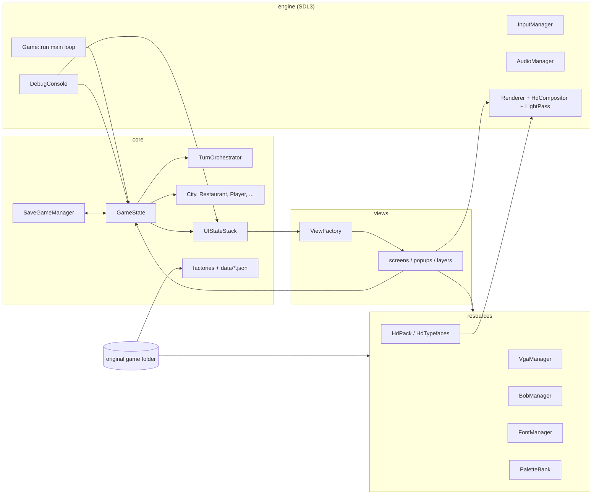

# Pizza Tycoon HD: technical blueprint

This folder is a source-verified map of the whole game: the engine, the original data
formats, the simulation, the screens, the content tables and the debug console. It is the
reference for a future modding SDK. Every statement points at the file and function it was
taken from; anything not implemented or not understood is marked as such.

The project is a C++20 reimplementation of the 1994 DOS game Pizza Tycoon (Pizza Connection),
"Pizza Legacy", extended by "Pizza Tycoon HD" with HD rendering, HD art packs and asset
export. The engine needs the user's copy of the English DOS release for all original art,
text, sound and data; none of it is in the repository or in this blueprint.

## Files

| File | Content |
|---|---|
| [file-formats.md](file-formats.md) | every original format the engine reads (palette, VGA, blitmap offsets, BOB, FNT, M audio containers with VOC/CMF, city/map/district files, characters, recipes, layouts, floor patterns, missions, text) with byte layouts; the engine's own formats (data JSON, HD fonts, `.plsave`, high scores, mission trailer, HD pack, asset export, warm list, settings) |
| [game-systems.md](game-systems.md) | the simulation: object model, clock and turn pipeline, cities, properties, restaurants, ingredients and suppliers, recipes and pizza quality, demand and competition, finance, staff, AI players, newspaper and trends, advertising, mayor, competitions, crime, careers and missions, rules and determinism |
| [screens.md](screens.md) | every screen, popup, layer and developer viewer: what it shows, how it is reached, the console `nav` command, assets, source |
| [content-data.md](content-data.md) | the data tables (`data/*.json`) field by field, the original files that act as content, and every content table still hard-coded in C++ |
| [console-commands.md](console-commands.md) | the debug console / `--exec` command reference, generated from the `CommandDef` definitions |
| [sdk-roadmap.md](sdk-roadmap.md) | staged plan for a modding SDK and an "Expanded" mode, with proposed JSON schemas, the refactors they need, and risks |

## Source layout

| Directory | Size | Role |
|---|---|---|
| `src/Main.cpp` | 1 file | command line (`parse_args`), starts `Game` |
| `src/engine/` | 120 files, about 13 000 lines | SDL3 platform layer: game loop (`Game.cpp`), renderer and HD compositor, GPU lighting, audio (`audio/`), input and bindings (`input/`), geometry types (`geom/`), 8-bit surfaces and palettes (`gfx/`), RNG, platform paths, screen console commands (`debug/`) |
| `src/resources/` | 46 files, about 5 200 lines | loaders for original formats and HD resources: `VgaLoader`, `BobLoader`, `FontLoader`, `PaletteLoader`, `MFileLoader`, `Blitmap`, `AssetMetadata`, `HdPack`, `HdTypeface`, `AssetExporter`, `VgaWriter`, `util/FileUtils`, `util/TextEncoding` |
| `src/core/` | 318 files, about 56 600 lines | the game: `state/` (GameState, turn pipeline, real estate, competitions, UI state), `city/`, `restaurant/`, `food/`, `supply/`, `finance/`, `character/`, `conversations/`, `newspaper/`, `marketing/`, `mission/`, `events/`, `economy/`, `item/`, `save/`, `factories/`, `tutorial/`, `debug/` (console) |
| `src/views/` | 335 files, about 48 100 lines | everything drawn: `screens/`, `ui/` (popups, widgets, presenters), `layers/` (overlays), `base/`, `factories/` (state to view), `viewers/` (asset viewers), `helpers/` |
| `data/` | 5 files + `fonts/` | engine data shipped next to the program: `furniture.json`, `ingredients.json`, `suppliers.json`, `trainings.json`, `fonts/` (OFL fonts + `hd_fonts.json`), `game_location.vga` |
| `tools/hdpack/` | Python | Python HD pack tools: `hdpack.py` (upscale, validate, doctor, comfy), `export.py`, `pixelart.py` (MMPX), `depthmaps.py`, `redraw.py`, `review_pairs.py` |
| `tools/ci/hd_gates.py` | Python | local CI gates: GPU vs CPU picture, game-state fingerprint unchanged by smooth motion, frame times |
| `tests/` | C++ | Catch2 tests (HD pack, images, compositor, text, asset export) |

The build enforces that `src/core` and `src/resources` never include `src/views`
(`tools/check_dependency_rule.cmake`).

## How the pieces fit

1. **Start-up** (`Game::run`, `src/engine/Game.cpp`): read `settings.conf`
   (`ConfigManager`); `--export-assets` exits here; configure HD (`Game::configure_hd`: scale,
   pack folder, HD typefaces) and start decoding the warm list; find the DOS game
   (`engine::find_dos_game`, `PT.EXE`) or show the game-location screen (drawn with a
   placeholder palette, `resources::load_fallback_palette`); once the game folder is known,
   `Game::load_game_data` loads `gfx/palette.e` and the fonts; push the intro (or a viewer); register console commands (`register_debug_commands`,
   `engine::make_screen_commands`); run `--exec` / `console` input if given.
2. **Main loop**: events and input, then fixed 30 Hz simulation ticks scaled by `time_scale`
   (`GameState::update`, which advances the DOS-style clock only on a human turn), view
   ticks, then rendering of the current view and overlays.
3. **State to view**: game code changes only `GameState` and pushes `UIState` values;
   `ViewFactory::create` (`src/views/factories/ViewFactory.cpp`) builds the view for the top
   state. Popups and the turn presenter are registered on `GameState` as callbacks
   (`TurnPresenterView`, `staff_event_presenter`, `monthly_entry_presenter`) so `core` stays
   free of view types.
4. **Turns**: `TurnOrchestrator` drains a step pipeline at the end of each player's turn and at
   the day boundary ([game-systems 2](game-systems.md#2-time-turns-and-the-day-cycle)).
5. **Resources**: loaders cache by key (`ResourceManager<T, Loader>`,
   `src/resources/ResourceManager.h`); keys are lower-case game paths (`gfx/back1`,
   `bob/moebel.bob`); palettes come from `AssetMetadata.cpp`.
6. **Rendering**: views draw into 640x400 8-bit indexed `gfx::Surface`s (originals are
   doubled on load). Each surface can carry HD pictures (`gfx::HdImage`, `gfx::HdList`) from the
   HD pack. `Renderer` composites layers; at `hd_scale > 1` the GPU draws HD quads over the
   expanded indexed pixels (`HdCompositor`) and applies 2D lights (`LightPass`, light sources
   from `RestaurantView::lighting`). Game logic never sees HD data.
7. **Saving**: `SaveGameManager` writes a zlib-compressed JSON document; cities are rebuilt
   from the original files on load and the saved dynamic state is applied on top.
8. **Console**: the same command tree serves the in-game console, `console <words>` on the
   command line and `--exec <file>` scripts; it is the main automation and test interface
   ([console-commands.md](console-commands.md)).

## HD pipeline in short

| Step | What | Where |
|---|---|---|
| Export | `--export-assets <dir>` writes every VGA picture and BOB frame as PNG at original size plus `manifest.json` | `resources::export_assets` |
| Make a pack | upscale or redraw the PNGs, same layout (`gfx/<name>.png`, `bob/<sheet>/<frame>.png`), same aspect ratio | `tools/hdpack/` |
| Validate | check the pack against the manifest | `tools/hdpack/hdpack.py validate` |
| Use | `--hd-scale 2..8` and `--hd-pack <dir>` (or options `hd_scale`, `hd_pack`, or an `hd` folder next to the program) | `Game::configure_hd`, `HdPack` |
| Text | TrueType fonts per bitmap font, `data/fonts/hd_fonts.json` | `HdTypefaces` |
| Lighting | per-furniture light sources in the restaurant, day/night ambient (HD only) | `RestaurantView::lighting`, `src/engine/Lighting.*`, `LightPass.*` |

Depth and normal maps (`tools/hdpack/depthmaps.py`) and SDXL redraws (`redraw.py`) are pack
tools; no engine code reads depth or normal maps.

## Command line

From `parse_args` / `usage` in `src/Main.cpp`:

| Option | Effect |
|---|---|
| (none) | normal start (intro) |
| `<file>` or `fonts`, `sounds`, `pal`, `char` | open a developer viewer |
| `console <cmd...>` | run one console line at start-up |
| `--config <file>` | settings file |
| `--game-path <dir>` | original game folder |
| `--exec <file>` | run console commands from a file, then exit (hidden window) |
| `--seed <n>` | RNG seed |
| `--vga <path>`, `--bob <path>` | viewers |
| `--card <text>` | title card |
| `--crt` | 4:3 aspect |
| `--hd-scale <1-8>` | HD render scale |
| `--hd-pack <dir>` | HD pack folder |
| `--export-assets <dir>` | write the original art as PNG + manifest, then exit |
| `-v`, `--version`, `-h`, `--help` | |

## Per-user files

`SDL_GetPrefPath("nl.pizzalegacy", "Pizza Legacy")` (`src/engine/PlatformPaths.cpp`):
`settings.conf`, `bindings.conf`, `hd_warm.txt` (next to the settings file), `saves/`
(`*.plsave`, `AUTOSAV<n>.plsave`, `highscore.dat`), `screenshots/`, `recipes/` (PREZ `.pc`),
`missions/` (`.mis`). Engine data: `<program dir>/data/`.

## Method and limits of this blueprint

* Written by reading the source at the state of the checkout (latest commit at the time:
  `94d616e`, plus uncommitted work in progress on HD text prewarming in
  `src/resources/HdTypeface.*` and `src/engine/Game.cpp`, which does not change anything
  described here). The C++ was not built or run for this work.
* The console reference was extracted mechanically from the `CommandDef` initialisers.
* Byte layouts are given as the loaders read them; offsets the loaders skip are listed as
  unknown in [file-formats 4](file-formats.md#4-unknowns).
* Behaviour that depends on the original executable's quirks is described as the engine
  reproduces it; where the code comments say the original differs or is a bug, the
  `fix_legacy_bugs` rule decides (see `docs/MODERNIZATIONS.md`).
