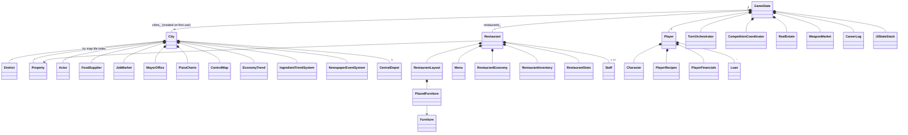
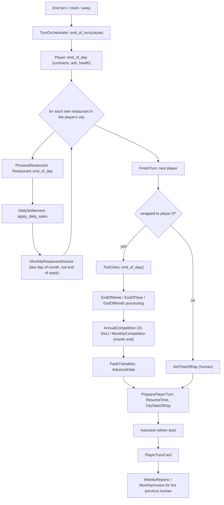
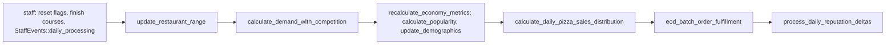

# Game systems

How the simulation works: the data structures, which functions run when, and the constants
that tune each system. All behaviour described here is in `src/core/` unless stated
otherwise. Numbers are quoted from the code; "Classic" means the 1994 rules the engine
reproduces, and `fix_legacy_bugs` refers to the rule of that name (`GameRules`,
`src/core/state/GameRules.h`) that corrects original bugs when on (default on).

Contents:

1. [Object model](#1-object-model)
2. [Time, turns and the day cycle](#2-time-turns-and-the-day-cycle)
3. [Cities and districts](#3-cities-and-districts)
4. [Properties, purchase and rent](#4-properties-purchase-and-rent)
5. [Restaurants](#5-restaurants)
6. [Ingredients, suppliers, stock and depots](#6-ingredients-suppliers-stock-and-depots)
7. [Recipes and pizza quality](#7-recipes-and-pizza-quality)
8. [Demand, popularity and competition](#8-demand-popularity-and-competition)
9. [Finance](#9-finance)
10. [Staff](#10-staff)
11. [AI players](#11-ai-players)
12. [Newspaper and ingredient trends](#12-newspaper-and-ingredient-trends)
13. [Advertising](#13-advertising)
14. [Mayor, inspections and awards](#14-mayor-inspections-and-awards)
15. [Pizza competitions](#15-pizza-competitions)
16. [Crime: mafia, police, weapons, sabotage, insurance](#16-crime-mafia-police-weapons-sabotage-insurance)
17. [Careers, milestones, missions and winning](#17-careers-milestones-missions-and-winning)
18. [Rules, options and determinism](#18-rules-options-and-determinism)

---

## 1. Object model

| Class | File | Role |
|---|---|---|
| `GameState` | `src/core/state/GameState.h/.cpp` | owns the world; `update(elapsed_ms)` advances the clock; initialisation, city loading, interruptions |
| `TurnOrchestrator` | `src/core/state/TurnOrchestrator.h/.cpp` | end-of-turn pipeline, day/week/month/year processing, deferred events |
| `RealEstate` | `src/core/state/RealEstate.h/.cpp` | buying, renting, selling premises; creating restaurants (human, AI, quick start) |
| `CompetitionCoordinator` | `src/core/state/CompetitionCoordinator.h/.cpp` | monthly and annual pizza competitions |
| `MilestoneTracker` | `src/core/state/MilestoneTracker.h/.cpp` | milestone checks and the win condition |
| `City` | `src/core/city/City.h/.cpp` | static city data plus per-city simulation state |
| `Restaurant` | `src/core/restaurant/Restaurant.h/.cpp` | one restaurant's state and its daily pipeline |
| `Player` | `src/core/character/Player.h/.cpp` | a company: character, recipes, money, loans, contracts, campaigns, crime state |
| `UIStateStack` / `UIState` | `src/core/state/UIStateStack.h`, `UIState.h` | the stack of screens (see [screens.md](screens.md)) |

Identifiers are typed wrappers (`core::PlayerId`, `CityId`, `RestaurantId`, `ActorId`,
`DistrictIndex`, `RecipeId`, `FurnitureId`, ...; `src/core/common/Ids.h`). Money is
`Money` in integer cents (`src/core/finance/Money.h`).

---

## 2. Time, turns and the day cycle

### 2.1 Clock

| Unit | Definition | Source |
|---|---|---|
| Simulation tick | 30 per second of real time (`simulation_tick_ms = 33`), multiplied by `time_scale` | `GameState.h`; game loop in `Game::run` (`src/engine/Game.cpp`) |
| PIT tick | 54 925 microseconds (the DOS timer); 18 PIT ticks = one game second | `pit_tick_us`, `pit_ticks_per_second` (`GameState.h`) |
| Game second | counter `second_in_block_`, wraps at 256 | `GameState::advance_second` |
| Time block | 10 minutes of game time; one block passes after `seconds_per_block = 11` game seconds while the clock is `Running` | `GameTime::BLOCKS_PER_DAY = 144` (`src/core/time/GameTime.h`), `TimeOfDay` (`src/core/time/TimeOfDay.h`) |
| Date | days since 1-Mar-1995 (`game_start_date`), 365-day years, no leap years | `src/core/time/GameDate.h` |
| Week | a running 7-day counter from the start date, not the calendar weekday; day index 6 is end of week | `GameDate::week_day_index` |

The clock runs only on a human player's turn (`GameState::update`). Each view chooses a
`ClockRate` (`Running`, `SecondsOnly`, `Stopped`; `src/core/state/ClockRate.h`,
`View::clock_rate`). Opening some screens costs time: the city view side buttons charge 1
block (`side_menu_charge_blocks`, `CityView.cpp`), restaurant sub-screens 1 block, the staff
screen 2 (`screen_charge_blocks`, `staff_screen_charge_blocks`, `RestaurantView.cpp`);
flying to another city charges none (`EuroMap::attempt_flight`).

Interruptions (calls, staff events, racket offers) are offered every
`seconds_between_interruption_windows = 8` game seconds in a rotating phase
(`InterruptionPhase`: queued events, staff events, protection racket, unused;
`GameState::run_interruption_pass`). Whether a screen allows them is its
`InterruptionRate` (`src/core/state/InterruptionRate.h`).

### 2.2 Turns

The game is hot-seat over 8 player slots (`NUMBER_OF_PLAYERS = 8`). Every slot, human or AI,
takes one turn per day in order 0..7. A human turn starts at the player's start-of-day hour
(default 9:00) and ends when the player presses End turn, when the clock passes the player's
end of day (computed from energy, `Player::determine_end_of_day`), or immediately when the
player is in prison or on holiday. AI turns end at once.

The pipeline is a deque of `turn::Step` variants (`src/core/state/TurnPipeline.h`) built by
`TurnOrchestrator::end_of_turn` and `build_turn_pipeline`, drained by `advance_pipeline`. A
step that shows a screen returns `Waiting`; its completion callback calls
`advance_pipeline()` again.

Scope: a human player's restaurants are processed only in the city the player is in
(`is_restaurant_in_processing_scope`, `GameState::simulated_cities_for`). Restaurants in other
cities earn a weekly profit extrapolated from the days the player was away
(`collect_weekly_city_profits`, `src/core/finance/TurnInvoices.cpp`). Cities without a human
player are not ticked (`tick_active_cities`); the weapon market drifts in every city.

### 2.3 Day, week, month, year

| When | Function | What it does |
|---|---|---|
| Start of a player's day in a city (once per day per city) | `TurnOrchestrator::run_city_start_of_day` | weekly economy trend tick and trend re-seed on week day 0; AI menus; pizza chart rebuild; control map rebuild; market share milestones; police district draw on day 20; newspaper `daily_update`; mayor scheduling and awards |
| Start of the owner's turn (`PreparePlayerTurn` step) or the owner's arrival in the city, whichever comes first (`TurnOrchestrator::begin_restaurant_day` guards it) | `execute_pipeline_step` (`PreparePlayerTurn`), `GameState::on_city_entered` | each own restaurant's `Restaurant::start_of_day` (closure countdown, protection timer, inspection countdown; a due inspection is queued as a mayor call); at turn start also depot raids (`raid_depots`) and depot deliveries to restaurants (`deliver_depot_stock`); on arrival the arrival milestone |
| Each human end of turn | `Player::end_of_day` / `end_of_day_human` | staff forgiveness, recipe sales rotation, advertising cost and campaign countdown, holiday/jail health, `process_contracts` (supplier deliveries) |
| Each restaurant at end of turn | `Restaurant::end_of_day` | see 5.4 |
| All players done | `TurnOrchestrator::end_of_day` (step `TickCities`) | resets per-day flags; `City::end_of_day` for simulated cities (supplier stock and prices, trends tick, refused calls, and on the last day of the week `City::end_of_week_tick`: embargo and spoilage counters, job market rotation, loyalty decay); weapon market; world domination check; depot theft in the active city (1 % per player); AI willingness decay |
| End of week | `end_of_week_processing` (step after `TickCities`) | vendor spending reset; `Player::end_of_week` (bankruptcy on unpaid supplier debt); liquidity record; 30 % chance one consumer type's taste profile is re-randomised; the `WeeklyReports` step then posts staff wages, electricity when the month also ends, and other cities' profits (through the report popups in `src/views/ui/finance/TurnInvoicePopups.cpp`, or `core::finance::apply_weekly_settlement` when no presenter is registered) |
| End of month | `end_of_month_processing` | `City::end_of_month` (premise availability rolls); monthly invoice (rent, loans, insurance, investments; `collect_monthly_costs`); monthly competition |
| End of year | `end_of_year_processing` | characters age by 1; books closed; annual competition |

Autosave frequency (`AutosaveFrequency`: off, daily, weekly, monthly) is checked when the day
wraps and skipped when all humans are away or in the tutorial (`is_autosave_due`,
`all_human_players_away`).

---

## 3. Cities and districts

Built by `CityFactory::create_city(id, fix_legacy_bugs, player_chars)`
(`src/core/factories/CityFactory.cpp`) when a city is first needed
(`GameState::city_or_create`). Steps: district colours, `cityN.pc`, `bezN.dat`, `mapN.dat`,
tile classification, properties, actors and settings, suppliers, advertising rates, known
arms dealers, 10 economy-trend ticks, random ingredient trends (5 % static value in
-20..19, 8 % linear trend), job market init.

| Data | Type | Notes |
|---|---|---|
| Map | 160x120 tile bytes | file-formats 1.9 |
| District grid | 20x15 cells of 8x8 tiles | `City::district_by_index` |
| Districts | `District` (`src/core/city/District.h`) | fields from the 104-byte record; `average_income() = 9000 - factor * 80` |
| Actors | `Actor` (`src/core/character/Actor.h`) | realtors, banks, insurers, mayor, police, mafia, arms dealers; phone numbers; head sprite |
| Food suppliers | `FoodSupplier` (`src/core/supply/FoodSupplier.h`) | category, quality, price levels, stock, relationship per player |
| Job market | `core::character::JobMarket` | which characters can be hired |
| Economy trend | `EconomyTrend` | weekly; 60-entry history; feeds the control map threshold |
| Interest rate | `City::interest_rate_` | starts at 8 %, moved by newspaper events |
| Spoilage, embargo | `City::spoilage_rate_`, `trade_embargo_counters_` | set by events; embargoes only enforced with `fix_legacy_bugs` (see `EuroMap::render`) |

City-level statistics:

* `ControlMap::build` (`src/core/city/ControlMap.cpp`): each 8x8-tile cell goes to the
  restaurant with the highest influence above a threshold `round(40 - economy/3) * 64`;
  influence uses range and the sum of the restaurant's competitive strengths. Market share is
  the number of cells held (`has_market_share_at_least`).
* `PizzaCharts::build` (`src/core/city/PizzaCharts.cpp`): top pizzas by rolling daily sales,
  including named AI pizzas.

---

## 4. Properties, purchase and rent

`Property` (`src/core/city/Property.h`) is created for every premise tile
(`CityFactory::populate_properties`):

| Field | Rule |
|---|---|
| size | width drawn from a triangular distribution around the district's average size, height = width - rand(modifier); both clamped to 10..20 tiles |
| kitchen | width triangular around average - 3, clamped 12..20; height = width - rand(4) |
| door offsets | random |
| realtor | random realtor of the city |
| status | with `premises_availability` % chance for sale, for rent or both, else not available; re-rolled monthly (`City::end_of_month`) |
| purchase price | `price_level * w * h` dollars; depots x5 (`depot_price_multiplier`) |
| monthly rent | `rent_level * w * h` dollars; depots x5 (`Property::get_monthly_rent`) |
| potential customers | per consumer type, summed over tiles within Manhattan distance `range` (7 by default, or the restaurant's range) with tile weights x half the district's population weight (`Property::calculate_demographics`); computed lazily and refreshed each processed day |

Transactions are in `RealEstate` (`buy_restaurant`, `rent_restaurant`, `buy_depot`,
`rent_depot`, `sell_property`, `end_property_lease`). The realtor conversation
(`src/core/conversations/RealtorConversation.cpp`, settings `RealtorSettings`) handles
haggling; a failed haggle writes the agreed price back (`Property::purchase_price`).

---

## 5. Restaurants

### 5.1 Structure

| Part | Class | Notes |
|---|---|---|
| Layout | `RestaurantLayout` (`src/core/restaurant/RestaurantLayout.h`) | dining room and kitchen sizes, door offsets, floor pattern, placed furniture and kitchen furniture |
| Furniture | `PlacedFurniture` -> `Furniture` (from `furniture.json`) | position, rotation, link from chair to table |
| Menu | `core::restaurant::Menu` (`src/core/restaurant/Menu.h`) | up to 24 recipes with prices of 1..50 dollars; per-entry `quality_base` |
| Staff | `Staff` slots: 6 cooks, 6 waiters, 1 manager (`MAXIMUM_STAFF_PER_CATEGORY`) | |
| Inventory | `RestaurantInventory` | grams, weighted quality and cost per ingredient; 650 kg cap per ingredient |
| Economy | `RestaurantEconomy` | range, appeal, strength, customers |
| Stats | `RestaurantStats` | today, yesterday, history |
| Hours | 9:00-21:00 by default | `Restaurant::DEFAULT_OPENING_TIME` / `CLOSING_TIME` |

A new human restaurant starts empty (`RealEstate::create_restaurant`); quick start uses
`q/fN.pc`; AI restaurants use `f/fN.pc` (11.1).

### 5.2 Capacity

| Quantity | Formula | Function |
|---|---|---|
| Oven throughput | sum over kitchen items of `capacity * operating_minutes / bake_time` | `calculate_daily_oven_throughput` |
| Cook / waiter throughput | sum of `pizzas_per_day` of present staff, x0.8 when late | `calculate_daily_chef_throughput`, `calculate_daily_waiter_throughput` |
| Seating capacity | `operating_minutes * seats / avg_seating_time` | `calculate_seating_capacity`, `calculate_service_time_data` |
| Electricity | oven throughput x 3 dollars per month | `calculate_electricity_cost` |
| Coin machines | per GAMES item 3 x (rand(young people) + rand(20)) dollars, per SLOT_MACHINES item 2 x the same | `calculate_slot_machine_income` |

### 5.3 Quality and stars

`Restaurant::calculate_pizza_quality_rating`: base = stock quality/4 + cook quality/4 + oven
quality/4 + sabotage contamination >> 2. Per menu pizza, if the weaker of staff quality and
that pizza's ingredient quality is below 16, the pizza's quality is `(base + min)/2`,
otherwise `base`. The restaurant rating (0..100) is the mean.

Mayor inspection (`TurnOrchestrator::show_next_deferred_inspection`): first a favour roll (chance = the
player's mayor favour score, 0..200) grants a star outright (max 5); otherwise
`Restaurant::update_star_rating` gains a star when rating > `stars*16 + 24` (max 5) and loses
one when rating < `stars*16 + 8`. Losing a star on the first inspection force-closes the
restaurant for 7 days.

### 5.4 Daily pipeline (human-owned, open)

All in `Restaurant::end_of_day` (`src/core/restaurant/Restaurant.cpp`). A closed or
force-closed restaurant only records an empty day and decays reputation. AI-owned restaurants
run a short version (11.2).

* Range: `range_raw` starts at 50 and grows by 1 with 50 % chance per day while below 120,
  capped at 200; `range_tiles = floor(sqrt(range_raw))` (`RestaurantEconomy::update_restaurant_range`).
* Fulfilment (`eod_batch_order_fulfillment`): predicted orders per menu line are clamped by
  oven, then cook, then waiter capacity, then by stock; a manager set to "act yourself" adds
  their own output where staff is short. Shortages post status messages.

---

## 6. Ingredients, suppliers, stock and depots

* Ingredient definitions: `ingredients.json` ([content-data.md](content-data.md#12-ingredientsjson)).
* Base price per ingredient and city: `cityN.pc` offset 2026, stored per city
  (`City::ingredient_base_prices`).
* Supplier price: `round(base * difficulty_multiplier * price_level / 100)` cents per kg,
  with `price_multiplier(difficulty)` = 0.6, 0.8, 1.0, 1.5, 1.9 for difficulty 1..5
  (`FoodSupplier::calculate_price`, `price_multiplier`).
* Daily supplier update (`FoodSupplier::daily_update`, called from `City::end_of_day`): stock
  falls by `(trend + 130) * 5` kg; for the one category whose turn it is
  (`GameState::next_price_update_category`), price level =
  `clamp(sqrt(12000 / stock) * price_factor + trend * 0.25, 20, 250)`. One random category is
  restocked by 4-12 t when below 10 t (`City::replenish_supplier_stock_levels`).
* Delivery failure chance: `clamp(25 - quality/4, 0, 100)` % (`chance_of_no_delivery`).
* Loyalty: spend rank = total spent / (4 x loyalty amount) (`spending_rank`); each week the
  total is reduced by the loyalty amount (`City::end_of_week_tick`).
* Buying: one-off orders (`buy_for_restaurant`, `buy_for_depot`, `ship_between_depots` in
  `src/core/supply/StockOrder.cpp`) and contracts (`SupplierContract`,
  `opening_contract_terms`, `sign_contract` in `src/core/supply/SupplierContract.*`;
  negotiated in `SupplierConversation`). Contracts deliver daily in `Player::process_contracts`.
* Central depot: one `CentralDepot` per player per city (`src/core/city/CentralDepot.h`);
  capacity comes from owned or rented depot premises; delivery priority list of up to 12
  restaurants; theft; exports to another city's depot cost the Euro map distance price
  (`EuroMap::calculate_cost`).
* Spoilage: `City::spoilage_rate` (1 normal, 8 during a heat wave).

---

## 7. Recipes and pizza quality

| Item | Source |
|---|---|
| Recipe storage | `core::food::PlayerRecipes` (`src/core/food/PlayerRecipes.h`): 14 standard slots plus user recipes; ids from one counter `next_id` |
| Recipe | `core::food::Recipe` (`src/core/food/Recipe.h`): id, name, origin, `Pizza`, 7-day sales history |
| Pizza | `core::food::Pizza` (`src/core/food/Pizza.h/.cpp`): toppings and derived stats |
| Topping | `core::food::Topping` (`src/core/food/Topping.h/.cpp`): ingredient, state, centre position |
| Files | `PizzaFactory` (read), `io::recipe::save_prez` (write) |

Stats (`Pizza::compute_physical_stats`, constants at the top of `Pizza.cpp`):

| Stat | Formula |
|---|---|
| fat/sweet/salty/hot (0..100 in steps of 10) | `clamp(sum(value * grams * (intensity >> 1)) / (250 + total grams), 0, 10) * 10` |
| calories | sum over ingredients of grams x calories / 100 |
| appearance | `100 - penalty/8`, penalty = sum over toppings of the distance beyond 120 engine pixels from the centre (232, 234) in x and y |
| refinement | `100 * sum(chop level) / (2 * toppings)` |
| normality | 100, reduced by `70 - 10 * distinct` % when fewer than 5 ingredient types, x0.8 below 700 g, x0.5 below 400 g |
| herb score | herb grams / 3, max 10 |
| popularity per consumer type | `si = 100 - 4 * sum(|taste - pizza taste/10|)`; user recipes lose `(60 - appearance)/2`; then `si * (normality for user recipes, imitation for standard) / 100` (`calculate_demographic_scores`) |

Taste profiles (`CustomerTasteProfiles`, defaults in `src/core/food/CustomerTasteProfiles.h`)
are part of the game state and change at the end of a week (30 % chance) and through two
newspaper events.

Imitation (copy accuracy against a reference pizza): `Pizza::finalize_against` with either
`compare_to_other_pizza` (strict, per topping position, chop and rotation) or
`compare_pizza_composition` (relaxed: ingredients and weights). The rule `pizza_judging`
chooses (`src/core/food/PizzaJudging.h`). Five judge scores split the total.

"Copy protection": a human restaurant with fewer than 3 standard pizzas on the menu or an
average imitation below 30 has its competitive strength divided by 8 and, when under
competition, a third of the customers; the customer count is also scaled by the average
imitation (`RestaurantEconomy::calculate_competitive_strength`,
`calculate_demand_with_competition`).

---

## 8. Demand, popularity and competition

Per restaurant per day (`src/core/restaurant/RestaurantEconomy.cpp`, `Restaurant.cpp`,
`PizzaDemand.cpp`):

1. Competitive strength per consumer type:
   `clamp(sqrt(max((furniture_appeal + total_popularity) * menu_factor, 0)) * quality_rating / 100, 1, 250)`.
2. Competition: every other open restaurant in the same city within `range + 10` tiles adds
   a penalty per consumer type of `strength - 4 * distance` when the distance is within its
   range + 1. Scores start at 100 each.
3. Customers: if our strength >= the competition score we get the full potential customers of
   the property; otherwise `potential * strength / score`. Capped by seating capacity (AI:
   `ai_customers_per_day`); the excess is the rejection rate.
4. Popularity components (`Restaurant::calculate_popularity`, only after the first opening):
   waiting time `(18 - service minutes) * district factor / 50`; pizza prices 0 (disabled in
   the original); recipes on menu (penalty for fewer than 3 standard, bonus over the
   district's desired counts); advertising (sum of channel effectiveness / 2); stars
   (`stars^2 + 4`); furnishing 0 (disabled in the original); demand fulfilment
   `-((100 - fulfilment) >> 3)` (with rule `demand_fulfillment_popularity`); unexpected events
   (reputation penalties).
5. Furniture appeal: `clamp((floor + furniture + jukebox/TV bonus) / 2, 0, 150)`; jukebox and
   TV give +12 to the consumer type they target and -4 to the others.
6. Sales per pizza: customers of each type split over menu pizzas in proportion to
   `PizzaDemand::calculate`: pizza popularity + ingredient trend bonus (sum of the trends of
   its 4 primary ingredients, clamped to +-125), times a district ratio from `quality_base`,
   `demographic_base` and `demographic_factor`, minus a price penalty
   (`calculate_price_income_modifier`). With `p = max(price in dollars - 4, 1)`,
   `f` = the district's `average_income_factor`, `c = 8 - f/25`:
   penalty = `trunc(p ^ (f/250 + 1.3))`, and when `p <= c` it is further reduced to
   `trunc(penalty - (c - p) * 5)` (a bonus for cheap pizzas). The result is clamped to
   0..200. A pizza sells at most 250 + rand(5) a day.

---

## 9. Finance

| Part | Source | Notes |
|---|---|---|
| Ledger | `src/core/finance/Ledger.h/.cpp` | double-entry accounts: Property, Machines, Furniture, Weapons, Stock, Cash, Capital, Loan, DeliveryDebts, Debts, ProfitAndLoss |
| Monthly overview | `MonthlyCategory` | receipts: Sales, CoinMachines, Missions; spending: Staff, Rents, Stock, Machines, Furniture, Protection, Repayment, Others |
| Player books | `PlayerFinancials` (`src/core/finance/PlayerFinancials.h/.cpp`) | daily profit history, weekly city profits, days present, liquidity |
| Balance sheet | `BalanceSheet` (`src/core/finance/BalanceSheet.*`) | |
| Invoices | `src/core/finance/TurnInvoices.*` | daily sales, staff wages (weekly), electricity and coin machines (monthly), rent, loan, insurance, investments (monthly), other cities' profits (weekly) |
| Loans | `Loan` (`src/core/finance/Loan.h`) | 12 months; monthly principal and interest truncated to dollars; at most 4 (`MAX_NUMBER_OF_LOANS`) |
| Investments | `Investment` (`src/core/finance/Investment.h`) | bank offers half the cash, rounded; up to 4 per player |

Loan offer (`BankConversation::propose_loan`):
`creditworthiness = ((management + personality + experience + age) * 100 + 5 * popularity_multiplier + capital) / 100`,
`amount = creditworthiness * bank multiplier * 8 >> difficulty`, rounded up to thousands;
interest = city rate + bank modifier.

Bankruptcy and game over (`GameOverCause`, `src/core/state/UIState.h`): cash below zero after
paying staff (`GameState::deduct_staff_wages_for_restaurant`), unpaid supplier debt at the end
of the week (`Player::end_of_week`), death by the mafia; then `GameState::eliminate_player`.

---

## 10. Staff

| Part | Source |
|---|---|
| Characters | `core::character::Character`, `CharacterData` (`src/core/character/Character.h`); loaded by `CharacterFactory` |
| Hiring pool | `JobMarket` (`src/core/city/JobMarket.h/.cpp`): per city, slot status per character (available, reserve, hired by player N, player character); weekly rotation keeps 16-2d..26-2d candidates per job visible |
| Staff member | `Staff` (`src/core/character/Staff.h/.cpp`): job, payment, motivation, absence, training |
| Training | `Training`, `trainings.json`; `Staff::send_on_training`, `complete_course` |
| Events | `core::restaurant::StaffEvents` (`src/core/restaurant/StaffEvents.*`): late, sick, maternity, quit, raise, theft, destroyed cheese, blown-up oven, spilt wine, messed-up orders, forgot to open; dialogs from `t/pers.e`, `t/persf.e` |
| Manager | `ManagerRoutine` (`src/core/restaurant/ManagerRoutine.*`), `ManagerSettings` (`Restaurant.h`): shopping, price changes, overdraft, reactions to turnover and shortages, behaviour towards staff |
| Blacklist | fired staff refuse to work for the player for a while; daily charisma-based forgiveness (`City::run_staff_forgiveness`) |

Staff events are queued at the end of the day and shown the next day from 10:00, or flushed
when the player ends the turn (`TurnOrchestrator::process_restaurant_step`,
`show_next_deferred_staff_event`).

---

## 11. AI players

AI players use the same `Player` and `Restaurant` classes but a simplified economy
(`src/core/restaurant/AIEconomy.h/.cpp`, `ai::` namespace).

### 11.1 Restaurants

* On first entry into a city each AI player tries up to 8 times (each with chance =
  experience %) to open a restaurant in a random free premise
  (`RealEstate::create_ai_starting_restaurant`).
* Layout: `f/f{index}.pc` with `index = rand(3)*6 + 1 + bias*2 + (area > large ? 1 : 0)`, bias
  from the dominant consumer pair when intelligence is high enough (`ai_layout_index`,
  `ai_demographic_bias`, `src/core/state/RealEstate.cpp`); only the first 20 furniture items
  are placed (`opening_furniture_count`), more are added over time (`ai::invest_in_restaurant`).
* Menus: 10 AI menu slots of named AI pizzas (`ai::init_ai_menu`, `update_ai_menu`,
  `AiMenuSlot`).

### 11.2 Daily processing

`Restaurant::end_of_day` for an AI owner: quality rating +1 with chance = charisma % (up to
100), range update, competitive strength, reputation, demand with competition, then
`ai::process_restaurant_revenue`: revenue = customers x `ai_revenue_per_customer` dollars;
cost = tier x 50 + average menu factor / 20 x customers; days banked +1 per day.

`Player::ai_end_of_day` -> `ai::run_daily_evaluation`, `check_ai_expansion`: investment,
expansion (cooldown `ai_initial_expansion_cooldown = 3`), attacks (`ai::attack_competitor`:
stink bomb on the human competitor costing the most business; heavy attacks are always
repelled by mafia protection), closures (`ai::consider_closing`: under -50 days banked or more
than 3 competitors, then two courage rolls). One closure or heavy attack per city per day
(`TurnOrchestrator::ai_action_taken`).

---

## 12. Newspaper and ingredient trends

* `NewspaperEventSystem::daily_update` (`src/core/newspaper/NewspaperEventSystem.cpp`), per
  city at start of day: counts down 50 scheduled slots; 5 % chance of a random named event
  (1..50); 18 % chance of a random ingredient trend article; otherwise a random flavour
  article with a 10-day cooldown.
* Named events (`NewspaperEvent`) either change a trend (`IngredientTrendSystem::apply_effect`),
  set spoilage (heat wave, spring/summer only), set an embargo counter on a category (weeks),
  move the interest rate by 2..6 points, change a consumer type's taste, or only show text.
  Several original events affect the wrong ingredient; `fix_legacy_bugs` corrects some of
  them (comments in `execute_named_event`).
* Trends (`IngredientTrendSystem`, `src/core/city/IngredientTrendSystem.h/.cpp`): per
  ingredient a current value, target and mode (linear +-4 a day, exponential halving,
  countdown); daily tick from `City::end_of_day`; weekly re-seed.
* Articles: `ArticleDatabase` (`src/core/newspaper/ArticleDatabase.*`), id encoding in
  `NewspaperState` (1-50 flavour, 51-100 event, 0xC8 ingredient template).

---

## 13. Advertising

`AdvertisingCampaign` (`src/core/marketing/AdvertisingCampaign.h`), stored per player per city
per channel: flyers, posters (9 options), newspaper ads (mini-game, `NewspaperAdGame`), TV
(9 commercials, `CommercialFactory`). Each city rolls its own poster and TV prices and
effectiveness at creation (`City::init_advertising_options`: posters 30..59 % effective,
TV 50..99 %). Daily cost is charged at the end of a human turn; campaigns count down and the
channel effectiveness decays after a campaign ends (`Player::update_campaigns`,
`ad_effectiveness`). The effect on demand is the advertising popularity component (8.4).
Screen: `Advertising` (`src/views/screens/Advertising.cpp`).

---

## 14. Mayor, inspections and awards

`MayorOffice` (`src/core/city/MayorOffice.h/.cpp`), one per city:

* favour score per player (0..200, +1 per 1000 dollars donated to the private account,
  decays 1 a day; used as a percent chance to pass inspections);
* appointment day for donations;
* quarterly awards (`MayorAwardType`: most beautiful restaurant, pizza of the year, best
  investor, best imitator (more than 4 competition wins), golden bow tie, trans-Atlantic
  trade), with a 2000-dollar participation fee; scheduled by `process_daily_scheduling`,
  scored in `GameState::score_and_grant_mayor_award`;
* inspections: a restaurant's countdown (`inspection_days_remaining`) ticks while open; the
  mayor's call is queued for a block between 9:00 and 13:50
  (`TurnOrchestrator::roll_inspection_block`) and changes stars (5.3), with the favour roll
  first.

Calls from the mayor and the police use 4 queue slots per player
(`TurnOrchestrator::call_slots_per_player`); calls not received are dropped at the end of the
day.

---

## 15. Pizza competitions

`CompetitionCoordinator` (`src/core/state/CompetitionCoordinator.*`):

* Monthly (month end): each human may enter with a bet; the reference pizza is
  `r/r{20 + min(wins, 40) + rand(10)}.pc` (`reference_pizza_index`); the player rebuilds it in
  the pizza designer; AI entries are simulated; winners take the pot
  (`finalize_competition_results`).
* Annual (31 December): mayor-run competition flow (`AnnualCompetitionFlow`).
* Challenges against an opponent from the opponent's restaurant view
  (`RestaurantView::challenge_check_and_start`).

---

## 16. Crime: mafia, police, weapons, sabotage, insurance

| System | Source | Summary |
|---|---|---|
| Protection racket | `GameState::roll_protection_racket` | 2 % per interruption window if the city has mafia and the player's underworld score is below 500; targets the first restaurant (random with rule `mafia_shakedowns_target_all_restaurants`) |
| Mafia | `MafiaConversation` (`src/core/conversations/MafiaConversation.cpp`), `MafiaPlayerState` | loans, protection, missions (`MafiaMissionType`: package, attack, weapon, laundering, investment) with deadlines checked each block (`GameState::check_mafia_deadlines`) |
| Arms dealers | `ArmsDealerConversation`, `WeaponMarket` (`src/core/economy/WeaponMarket.*`) | 8 items; base prices 400..1600 dollars for sabotage goods and 3600..9000 for weapons; per city 4 drifting modifiers giving 55..174 % of base |
| Police | `PoliceConversation`, `GameState::check_police_events`, `initiate_arrest` | 2 % chance per window when carrying weapons, avoided with chance = dexterity; arrests (`ArrestReason`) lead to jail. On day 20 the police draw a district (`run_city_start_of_day`); on days 1-19 of the following months, at the start of a human player's turn (`PreparePlayerTurn`), that player's depots in that district may be searched with 5 % chance per day and their weapons seized (`TurnOrchestrator::raid_depots`) |
| Sabotage and attacks | `Restaurant::apply_sabotage`, `AttackScene` (`src/views/screens/restaurant/AttackScene.cpp`) | contamination, reputation damage, destroyed furniture (ashes roles) |
| Insurance | `InsuranceConversation`, `InsurancePlayerState` | types: theft, warehouse, fire, liability, life; claims within the week |
| Social standing | `SocialStatus` (`src/core/character/SocialStatus.h`) | business and underworld scores with 14 rank thresholds scaled by difficulty |

---

## 17. Careers, milestones, missions and winning

* Milestones (`core::events::MilestoneId`, 1..140) are recorded per player in the CV
  (`CareerLog`, `src/core/events/CareerLog.*`; checks in `MilestoneTracker`); some show a
  full-screen picture `gfx/zw{N}` and add score (`milestone_data`).
* Missions: a mission is a target CV ([file-formats 1.15](file-formats.md#115-mission-files-mnmis));
  score = average over target milestones of `clamp(100 - date distance, 0, 100)` with a year
  weighing 45 units and a month 30 (`src/core/mission/MissionScoring.*`). Achieving the last
  milestone ends the game (`GameOverCause::MissionComplete`).
* Winning (free mode): `MilestoneTracker::check_world_domination` after every day; market
  share of at least 5 % of control-map cells in Paris, in any city, or in all 10 cities
  depending on `win_condition`; then the win sequence (`GameState::trigger_win_sequence`,
  `WinSequenceView`).
* Game modes: `GameMode::FREEMODE`, `MISSION_MODE`, `QUICKSTART` (`src/core/GameTypes.h`).
  Quick start gives each human a furnished restaurant from `q/fN.pc` and 4 standard pizzas.

---

## 18. Rules, options and determinism

* `GameRules` (stored in the save game): `fix_legacy_bugs`,
  `mafia_shakedowns_target_all_restaurants`, `demand_fulfillment_popularity`, `win_condition`
  (Paris, any city, all cities), `pizza_judging` (strict, relaxed), `cook_book`, `police`,
  `suppliers_remember_missed_payments`. A game keeps the rules it started with
  (`starting_rules`) and records changes (`rules_changed`). `docs/MODERNIZATIONS.md` lists
  what each changes.
* `GameOptions` (`src/core/state/GameOptions.h`, `settings.conf`): presentation only (audio,
  display, HD, input, autosave). The HD gates check that presentation options do not change
  game state (`tools/ci/hd_gates.py`, `debug dump fingerprint`).
* Randomness: `src/engine/Random.h/.cpp` has two 32-bit LCG streams (multiplier 1103515245,
  increment 12345, 15-bit output): the simulation stream (`engine::random::rand_max_n`,
  `rand_percentage_chance`, ...; state saved as `rng_state`, seeded by `--seed`) and a
  separate presentation stream (`engine::random::presentation::*`) for visual effects.
  `rand_max_n(n)` returns 0..n-1; `rand_percentage_chance` does not draw at 0 or 100. Any
  added or removed simulation draw changes every later result, so new features must not draw
  from the simulation stream in Classic code paths.
* Difficulty 1..5 affects prices (6), flight cost (x(d+1)), loan size (>> d), job market pool
  size, social rank thresholds.
