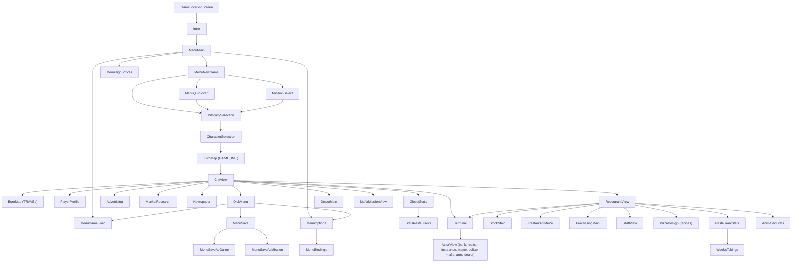

# Screens, popups and layers

Every view the engine can show, how it is reached, the console command that opens it, the
original assets it reads, and its source. The asset lists were collected from the string
literals in each view's source (`gfx/...`, `bob/...`, `t/...`) and the sound/music ids it
plays; pictures reached through shared widgets (buttons, panels, fonts) are listed once
under [shared UI](#6-shared-ui-and-widgets).

## 1. How screens work

* The screen stack is `UIStateStack` (`src/core/state/UIStateStack.h`) of `UIState`, a
  `std::variant` of one state struct per screen (`src/core/state/UIState.h`). Game code pushes
  states (`ui().push<CityViewState>(id)`, `replace_top`, `pop`); it never creates views.
* `ViewFactory::create()` (`src/views/factories/ViewFactory.cpp`) turns the top state into a
  `View`. Views derived from `MainPanelView` are wrapped in a `PaneledView`
  (`src/views/base/PaneledView.cpp`): the 640x400 screen with the right-hand side panel
  (`InputPanel` buttons, `StatusDisplay` messages, panel frame `gfx/bo`).
* Conversations with actors are `ActorView<LineEnum>` (`src/views/screens/ActorView.h/.inl`)
  around a `BaseConversation` subclass; `ActorViewFactory` picks the conversation by
  `ActorType` (`src/views/factories/ActorViewFactory.cpp`).
* Popups are created through `PopupManager::create<Popup>(...)`
  (`src/views/ui/PopupManager.h`); overlays (layers) are drawn above the current view.
* `UiMode::Menu` vs `UiMode::Game` selects cursor and popup styling (`is_menu_screen`).
* Every view picks how the clock runs while it is open (`View::clock_rate`,
  `src/views/base/View.h`) and whether interruptions may appear.

## 2. Start-up and menus

| Screen | State | Shows | Reached from | Console | Assets | Source |
|---|---|---|---|---|---|---|
| Game location | `ScreenTag::GameLocation` | asks for the original game folder | `Game::run` when no valid game path | `nav gameloc` | `data/game_location.vga` (engine file) | `src/views/screens/GameLocationScreen.cpp`, `GameLocationContent.h` |
| Intro | `ScreenTag::Intro` | logos, title pictures, credits | start-up (`Game::run`) | `nav intro` | `gfx/cyber`, `gfx/mplogolo`, `gfx/titel1`, `gfx/titel2`, `t/credits.e`; music `TEA_SHOPPE` | `src/views/screens/Intro.cpp` |
| Main menu | `ScreenTag::MenuMain` | load, new game, high scores, options | Intro, GameOver | `nav main` | `gfx/menu` | `src/views/screens/menus/MenuMain.cpp` |
| New game | `ScreenTag::MenuNewGame` | free game, mission, quick start | main menu | `nav ng` | menu widgets | `MenuNewGame.cpp` |
| Quick start | `ScreenTag::MenuQuickstart` | restaurant size choice | new game | - | | `MenuQuickstart.cpp` |
| Mission select | `ScreenTag::MissionSelect` | list of `m/*.mis` and player missions | new game | - | `m/{}.mis` | `MenuMissionSelect.cpp` |
| Difficulty | `ScreenTag::DifficultySelection` | 1..5 | new game, quick start, mission | - | | `DifficultySelection.cpp` |
| Characters | `ScreenTag::CharacterSelection` | 8 player slots, character, human/AI | difficulty | - | character portraits (`chr/`) | `CharacterSelection.cpp`, widgets `CharacterSelectionBox`, `CompanySelectionBox` |
| Load game | `ScreenTag::MenuGameLoad` | saves with metadata | main menu, disk menu | `nav load` | | `MenuGameLoad.cpp`, `SaveFileInfoBox` |
| High scores | `ScreenTag::MenuHighScores` | `highscore.dat` | main menu | - | | `MenuHighScores.cpp` |
| Options | `ScreenTag::MenuOptions` / `OptionsMenuState{screen}` | audio, graphics, controls, gameplay, rules | main menu, disk menu | `nav op [audio\|graphics\|controls\|gameplay\|rules\|bindings]` | | `MenuOptions.cpp` |
| Key bindings | `ScreenTag::MenuBindings` | action bindings | options | `nav op bindings` | | `MenuBindings.cpp` |
| Disk menu | `ScreenTag::DiskMenu` | save, old game (load), options, exit (with confirmation) | city view (Disk button) | `nav disk` | | `DiskMenu.cpp` |
| Save | `ScreenTag::MenuSave` | save as game / as mission | disk menu | - | | `MenuSave.cpp` |
| Save as game | `ScreenTag::MenuSaveAsGame` | name entry | save | - | | `MenuSaveAsGame.cpp` |
| Save as mission | `ScreenTag::MenuSaveAsMission` | writes the CV as `.mis` | save | - | | `MenuSaveAsMission.cpp` |
| Recipe export | `RecipeExportState` | name entry, writes a PREZ file | recipe list context menu | `nav pizza export <recipe_id>` | | `MenuRecipeExport.cpp` |
| Recipe import | `RecipeImportState` | recipe files with preview | recipe list context menu | `nav pizza import` | `bob/zutaten.bob` (preview) | `MenuRecipeImport.cpp`, `RecipePreview.cpp` |

## 3. World screens

| Screen | State | Shows | Reached from | Console | Assets | Source |
|---|---|---|---|---|---|---|
| Euro map | `EuroMapState{mode, category}` | 10 cities; modes `GAME_INIT` (pick start city), `TRAVEL` (fly; cost box), `DEPOT` (export target) | character selection, city view Map button, depot stock page | `nav euromap` (travel) | `gfx/euromap` (palette 2) | `src/views/screens/EuroMap.cpp` |
| City view | `CityViewState{city_id}` | the 160x120 map at 3 zooms (`ZoomLevel` close/medium/far), tabs Map / Districts / Control (`CityViewTabType`), highlight dropdowns (player, range, locations, properties), traffic | start of game, flight, end of turn when the next human is elsewhere | `nav cityview [city_id]` | `gfx/landsym`, `gfx/med1`, `gfx/back21`, `bob/stanbobs.bob`; sounds `TRAFFIC_1/2` | `src/views/screens/city_view/CityView.cpp`, `CityViewTab.h`, `ZoomConfig.h` |
| Player profile | `PlayerProfileState` | character, social and underworld rank, CV, medals | city view Character button | `nav profile [player_id]` | `gfx/back32`..`back35`, `gfx/orden`, `bob/stanbobs.bob`, `t/leben.e` | `src/views/screens/PlayerProfile.cpp` |
| Market research | `MarketResearchState{district}` | district statistics, close map | city view ? button | - | `gfx/back30`, `gfx/landsym`, `gfx/permap`, `bob/stanbobs.bob` | `src/views/screens/MarketResearch.cpp` |
| Newspaper | `ScreenTag::Newspaper` | current article with picture | city view Newspaper button | - | `gfx/back31`, `z/zb{N}`; text `z/artikel*.e` | `src/views/screens/Newspaper.cpp` |
| Advertising | `ScreenTag::Advertising` | flyers, posters, newspaper ad game, TV | city view Megaphone button | `nav advertising` | `gfx/back24`..`back27`, `gfx/back31`, `gfx/plakat0..8`; TV frames via `TVPlaybackEngine` (`gfx/spot0..8`, `gfx/tvmisc`) | `src/views/screens/Advertising.cpp`, `src/views/helpers/TVPlaybackEngine.cpp` |
| Company statistics | `GlobalStatsState{screen}` | 0 month overview, 2 cash flow, 3 loans, 4 insurance, 5 property, 6 balance, 7 daily profits (`GlobalStatsScreen`) | city view Graph button | `nav globalstats [0-7]` | `bob/stabo.bob`, `bob/stanbobs.bob` | `src/views/screens/GlobalStats.cpp` |
| Restaurants overview | `StatsRestaurantsState` | the player's restaurants on a small map (statistics screen 1) | company statistics | `nav globalstats 1` | `gfx/med1`, `bob/stanbobs.bob` | `src/views/screens/StatsRestaurants.cpp` |
| Terminal | `TerminalState{category}` | phone book: realtors, banks, insurance, authorities, others; dialling | city view / restaurant view Terminal button | `nav terminal` | `gfx/back28`, `gfx/blitmap5`; sounds `DIAL_TONE_*`, `PHONE_RINGING`, `PHONE_PICKUP` | `src/views/screens/Terminal.cpp` |
| Actor conversation | `ActorTerminalState{type,id}`, `BankState`, `MayorState`, `MafiaState`, `PoliceState`, `SupplierContractState` | talking head, dialogue lines, proposals, cheques | terminal; events (mayor, police, mafia); ingredient order (supplier contract) | `mafia ...`, `police ...`, `mayor ...`, `bank loan` | `gfx/back{ActorType}` (10-13 suppliers, 15 realtor, 16 bank, 17 insurance, 18 mayor, 19 police, 20 mafia, 22 arms dealer), `bob/typ{head}e.bob`; text `t/bank.e`, `t/makler.e`, `t/versich.e`, `t/bg.e`, `t/polizei.e`, `t/mafia.e`, `t/waffen.e`, `t/lief.e` | `src/views/screens/ActorView.inl`, `src/core/conversations/*Conversation.cpp` |
| Mafia mission | `MafiaMissionViewState{line}` | pickup / drop-off scene | clicking a mission location on the city map | - | `gfx/back38`, `t/mafia.e` | `src/views/screens/MafiaMissionView.cpp` |
| Depot | `DepotMainState{property}` | depot overview: stock, priorities, weapons | clicking an own depot on the city map | `nav depot` | `gfx/back3` | `src/views/screens/depot/DepotMain.cpp` |
| Depot weapons | `DepotWeaponInterfaceState` | move weapons between bag and depot | depot | - | `gfx/back14` | `DepotWeaponInterface.cpp` |
| Depot export | `DepotExportState{category, city, cost}` | ship stock to another city's depot | Euro map in DEPOT mode | - | `gfx/back9` | `DepotExportScreen.cpp` |
| Depot stock | `DepotIngredientCategoryViewState{category}` | depot stock per category | depot | `nav depot <category>` | `gfx/back9`, `gfx/permap` | `src/views/screens/stock/DepotIngredientCategoryView.cpp` |
| Depot supplier list | `DepotIngredientSupplierListState` | suppliers for buying/selling | depot stock | - | `gfx/back9` | `DepotIngredientSupplierList.cpp` |
| Depot order | `DepotIngredientOrderState` | order quantities | depot supplier list | `nav order <category> <supplier> depot` | `gfx/back9` | `DepotIngredientOrderScreen.cpp` |

## 4. Restaurant screens

| Screen | State | Shows | Reached from | Console | Assets | Source |
|---|---|---|---|---|---|---|
| Restaurant | `RestaurantViewState{id, mode, kitchen_view}` | dining room or kitchen with furniture, guests and staff; modes `PLAYER_DEFAULT`, `PLAYER_NEW_FURNITURE`, `OPPONENT_VIEW`, `OPPONENT_ATTACK`, `SABOTAGE`, `WEAPON_SELECT` (`RestaurantViewMode`) | clicking a restaurant on the city map | `nav restaurant [id]` | `bob/moebel.bob`, `bob/kuebobs.bob`, `bob/gaeste.bob`, `bob/walk{N}.bob`, `gfx/k0`, `gfx/k{vendor+1}`, `gfx/back14`; sounds `RESTAURANT_NOISE_1..3`; jukebox music `MusicId` 0..5 | `src/views/screens/restaurant/RestaurantView.cpp`, `FurniturePlacementController.cpp`, `GuestWalkScene.cpp`, `CharacterController.cpp`, `CharacterRenderer.cpp`, `SeatedCharacterRenderer.cpp`, `WalkNavigation.cpp` |
| Night attack | part of `RestaurantView` (`AttackScene`) | break-in animation | sabotage / attack | - | `bob/nightp.bob`, `bob/nightw0..3.bob`; music `BREAK_IN_MUSIC_1`; sounds `WEAPON_1/3/4`, `POLICE_SIREN` | `src/views/screens/restaurant/AttackScene.cpp` |
| Menu (prices) | `RestaurantMenuState` | menu entries and prices | restaurant Menu button | - | `gfx/back2`, `gfx/back9` | `RestaurantMenu.cpp`, `RecipeListRow.h` |
| Stock | `StockMainState` | stock overview per category | restaurant Stock button | `nav stock` | `gfx/back3` | `src/views/screens/stock/StockMain.cpp` |
| Stock category | `IngredientCategoryViewState` | stock and daily need per ingredient | stock | `nav stock <category>` | `gfx/back9` | `IngredientCategoryView.cpp` |
| Supplier list | `IngredientSupplierListState` | the city's suppliers for a category | stock category | - | `gfx/back9` | `IngredientSupplierList.cpp` |
| Ingredient order | `IngredientOrderState` | quantities and prices; leads to a contract conversation | supplier list | `nav order <category> <supplier>` | `gfx/back9` | `IngredientOrderScreen.cpp` |
| Contracts | `ContractsViewState` | running supplier contracts | stock category | - | `gfx/back5` | `Contracts.cpp` |
| Purchasing | `PurchasingState{type}` | equipment book: flooring, furniture, kitchen, extras | restaurant Furnishing button | `nav purchasing` | `gfx/back3` | `src/views/screens/purchasing/PurchasingMain.cpp` |
| Category overview | `CategoryOverviewState{type, demographics}` | a category's vendors, or the furniture-and-customers page | purchasing | `nav demographics` | `gfx/back9`, `gfx/k{N}` | `CategoryOverviewScreen.cpp` |
| Supplier list (equipment) | `SupplierListState{type, page}` | vendors of a type | category overview | `nav suppliers` | | `SupplierList.cpp` |
| Furniture list | `FurnitureListState{supplier}` | a vendor's furniture | supplier list | - | `bob/moebel.bob`, `bob/kuebobs.bob`, `gfx/back9` | `FurnitureListView.cpp` |
| Floor list | `FloorListState{supplier}` | a vendor's floor patterns | supplier list | - | `bob/moebel.bob`, `gfx/back9` | `FloorListView.cpp` |
| Staff | `ScreenTag::StaffView` | overview, applications, applicant card, training (`StaffScreen`) | restaurant Staff button (costs 2 blocks) | - | `gfx/permap`, `t/bewerb{N}.e`, character portraits | `src/views/screens/StaffView.cpp` |
| Restaurant statistics | `RestaurantStatsState{id, screen, automatic}` | 0 daily balance, 1 week review, 2 month review, 4 customers, 5 sales curve (`RestaurantStatsScreen`); also the automatic end-of-day report | restaurant Graph button; end of turn with `automatic_report` | `nav stats [id] [0-5]` | `bob/stabo.bob`, `bob/stanbobs.bob`, `gfx/permap` | `src/views/screens/restaurant/RestaurantStats.cpp` |
| Week's takings | `WeeksTakingsState` | the week's takings (statistics screen 3); end-of-week report | restaurant statistics; weekly reports | `nav stats [id] 3` | `bob/stanbobs.bob` | `WeeksTakings.cpp` |
| Animated statistics | `AnimatedStatsState{id, screen}` | production, reputation, capacity, pizza quality, popularity, turnover (`AnimatedStatsScreen`) | restaurant Up/Down button | - | `gfx/back37`, `gfx/back6`, `gfx/back9`, `bob/lebbo.bob`, `bob/stanbobs.bob` | `src/views/screens/AnimatedStats.cpp` |
| Pizza designer | `PizzaDesignState{mode,...}` | recipe list, view, ingredients, design, info, competition modes (`PizzaDesignMode`) | restaurant Recipe list button; competitions; challenges | `nav pizza design`, `nav pizza recipes` | `gfx/back1`, `gfx/back4`, `bob/zutaten.bob`, `gfx/permap`, `r/rN.pc`; sound `CHOPPER`; music `BREAK_IN_MUSIC_3` (competition) | `src/views/screens/pizza/PizzaDesign*.cpp`, `HalfSizePizza.cpp` |
| Judges | `PizzaJudgesState{scores}` | five judges scoring a pizza | pizza designer (bake / competition) | - | `gfx/jury` | `src/views/screens/PizzaJudges.cpp`, `src/views/helpers/JudgeAnimator.cpp` |

## 5. Turn and event screens

| Screen | State | Shows | Opened by | Assets | Source |
|---|---|---|---|---|---|
| Player turn card | `PlayerTurnCardState` | whose turn, date | `TurnPresenterView` from the `PlayerTurnCard` pipeline step | `gfx/back39` | `src/views/screens/PlayerTurnCard.cpp` |
| Full-screen milestone | `FullscreenStatusState{message}` | milestone picture and text | `GameState::deliver_milestone` | `gfx/zw{N}`, `t/levent.e` | `src/views/screens/FullscreenStatus.cpp` |
| El Maestro message | `MaestroMessageState{text}` | full-screen message | floor editing bonus; pizza designer | `gfx/maestro` | `src/views/screens/MaestroMessage.cpp` |
| Game over | `GameOverState{player, cause}` | bankruptcy, death, mission complete | `GameState::eliminate_player`, `MafiaConversation` | `gfx/maestro` | `src/views/screens/GameOver.cpp` |
| Win sequence | `WinSequenceState{line, player}` | ending text pages | `GameState::trigger_win_sequence` | `gfx/ende`, `t/ende.e` | `src/views/screens/WinSequenceView.cpp` |

## 6. Popups

Created through `PopupManager::create<...>` (`src/views/ui/PopupManager.h`); base class
`BasePopup` (`src/views/ui/popups/BasePopup.cpp`).

| Popup | Purpose | Opened from | Assets | Source |
|---|---|---|---|---|
| `AlertPopup` | message with OK | many (turn presenter, staff events, pause, menus, restaurant, depot) | | `src/views/ui/popups/AlertPopup.cpp` |
| `ConfirmPopup` | yes/no | competitions, tutorial, staff, game over, disk menu, saves, furniture placement, profile | | `ConfirmPopup.cpp` |
| `OptionsPopup` | 3-choice staff event answers | `StaffEventPopups`, `staff event` command | | `OptionsPopup.cpp`, `src/views/ui/staff/StaffEventPopups.cpp` |
| `NumberInputPopup` | amount entry | competitions (bet), staff (amounts in 50-dollar steps), profile, restaurant, pizza designer | `bob/stanbobs.bob` | `NumberInputPopup.cpp` |
| `TextInputPopup` | text entry | game over, pizza designer and recipe list (names), BOB viewer | | `TextInputPopup.cpp` |
| `ChequePopup` | writing a cheque (amount and account) when a conversation asks for one | `ActorView` when a conversation requests `PopupRequest::CHEQUE` | `gfx/back36` | `ChequePopup.cpp` |
| `InvoicePopup` | invoices | turn invoices, furniture purchase | | `InvoicePopup.cpp`, `src/views/ui/finance/TurnInvoicePopups.cpp` |
| `ContextMenuPopup` | right-click actions | recipe list (`PizzaDesign::open_recipe_menu`): show recipe; show cook book (standard pizzas, rule `cook_book`); export to disk and rename (user recipes); import from disk (the NEW row) | | `ContextMenuPopup.cpp` |
| `CookBookPopup` | standard pizza recipe page (rule `cook_book`) | pizza designer | `gfx/back1`, `bob/zutaten.bob` | `CookBookPopup.cpp` |
| `GuestTalkPopup` | a guest's remark | clicking a guest | `gfx/g{N}`, `t/gtalk0.e`, `t/gtalk1.e` | `GuestTalkPopup.cpp` |
| `JukeboxPopup` | pick a station (targets a consumer type) | clicking a jukebox | music `MusicId` 0..5 | `JukeboxPopup.cpp` |
| `TvPopup` | pick a channel (targets a consumer type) | clicking a TV | | `TvPopup.cpp` |
| `TutorialPopup` | tutorial step text | `TutorialLayer` | | `TutorialPopup.cpp` |
| Competition popups | entry, bet, speed | `CompetitionCoordinator` via presenter | | `src/views/ui/competition/CompetitionPopups.cpp` |
| Turn invoice popups | weekly wages, electricity, monthly costs, city profits | `WeeklyReports`, `MonthlyInvoice`, `MonthlyRestaurantInvoice` steps | | `src/views/ui/finance/TurnInvoicePopups.cpp`, `src/views/ui/TurnPresenterView.cpp` |

## 7. Layers (overlays)

| Layer | Purpose | Source |
|---|---|---|
| `ConsoleLayer` | debug console (action `ToggleConsole`, unbound by default) | `src/views/layers/ConsoleLayer.cpp` |
| `DebugLayer` | debug drawing | `DebugLayer.cpp` |
| `GameInfoLayer` | "what the game is doing" captions, time scale | `GameInfoLayer.cpp` |
| `PauseLayer` | pause | `PauseLayer.cpp` |
| `TooltipLayer` | tooltips | `TooltipLayer.h` |
| `TurnLockLayer` | blocks pointer input and shows a busy cursor while the turn pipeline runs | `TurnLockLayer.cpp` |
| `TutorialLayer` | tutorial step, limits clicks | `TutorialLayer.cpp` |

## 8. Developer viewers

Opened from the command line (`parse_args`, `src/Main.cpp`; `create_viewer` in
`ViewFactory.cpp`), state `ViewerState`:

| Invocation | Viewer | Source |
|---|---|---|
| `<file>.vga`, `--vga <file>` | VGA picture with its palette; blitmaps show their offset rectangles | `src/views/viewers/VgaViewer.cpp` |
| `<file>.bob`, `--bob <file>` | BOB frames | `BobViewer.cpp` |
| `fonts` | all fonts | `FontViewer.cpp` |
| `sounds` | all `sound/mN` entries | `SoundViewer.cpp` |
| `pal` | the 71 palettes | `PaletteView.cpp` |
| `char` | seated characters | `CharacterViewer.cpp` |
| `--card <text>` | title card for trailers (`\|` = line break) | `CardViewer.cpp` |

A file inside the game folder is opened by its game key (for example `gfx/titel1`) so it gets
the game's palette and any HD pack art (`asset_key_for`).

## 9. Shared UI and widgets

| Element | Assets | Source |
|---|---|---|
| Side panel frame | `gfx/bo` | `src/views/base/PanelContainerView.h` |
| Buttons and icons | `gfx/permap` (button plates), `gfx/icons` (`Icon` cells 32x26) | `src/views/ui/widgets/Button.cpp`, `src/views/ui/Icon.h` |
| Busy cursor | `gfx/icons` | `src/views/ui/BusyCursor.cpp` |
| Menus | `bob/menubobs.bob` | `src/views/base/Menu.cpp`, `src/views/ui/widgets/ArrowMenuItem.cpp` |
| Page decorations, binders, bars, quality icons | `gfx/blitmap1..4` via `BlitmapManager` | `src/views/ui/PageDecoration.cpp`, `src/resources/BlitmapManager.cpp` |
| Text | `fonts/*.fnt`; HD typefaces from `data/fonts` | `src/resources/FontManager.cpp`, `HdTypeface.cpp` |
| Status messages | | `src/views/screens/StatusDisplay.cpp`, `src/core/status/StatusHub.*` |
